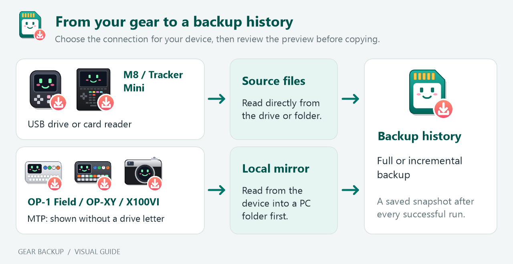
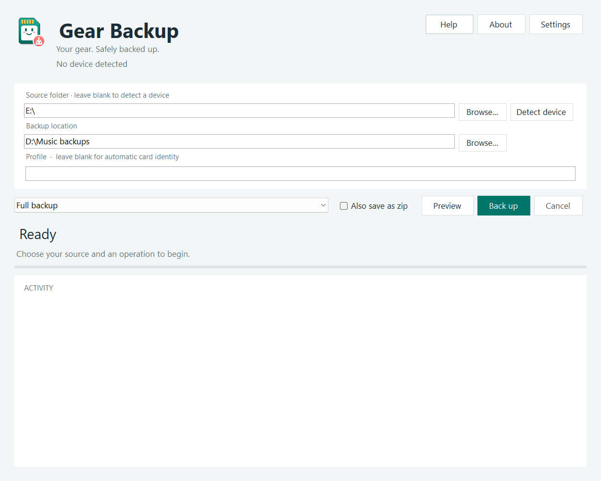
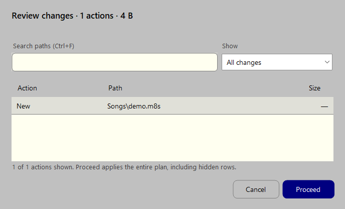
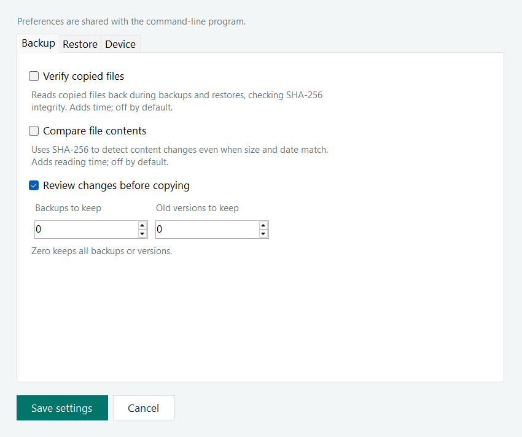
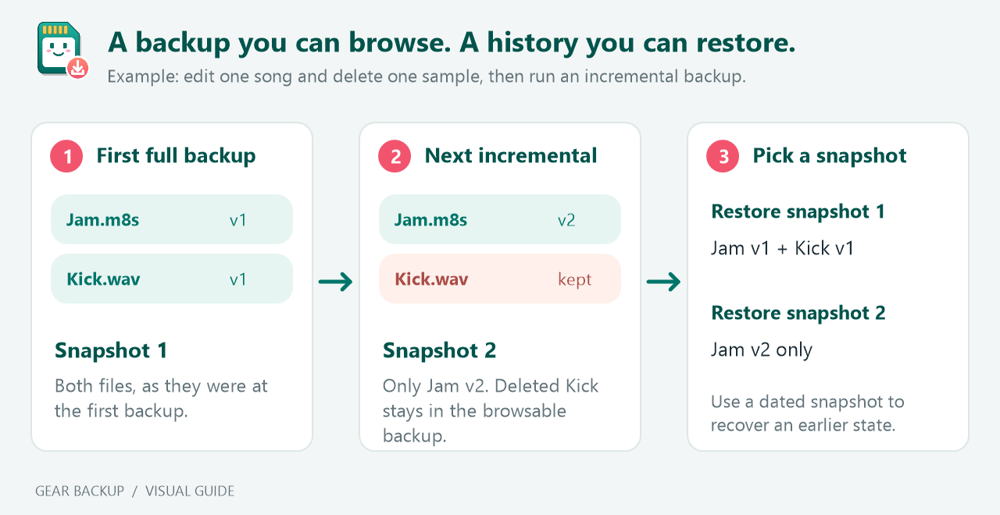
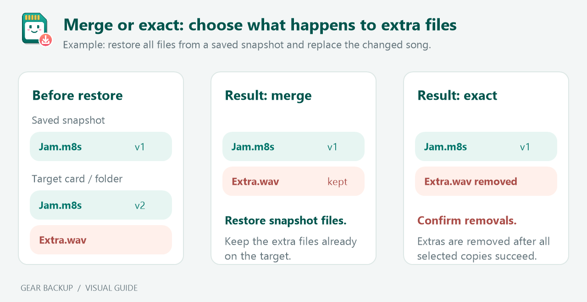

# Gear Backup — Manual

Gear Backup is a Windows program with graphical and command-line interfaces for backing up the Dirtywave M8, Polyend Tracker Mini, Teenage Engineering OP-1 Field and OP-XY, Fujifilm X100VI, and local folders. It makes full or incremental backups, keeps dated snapshots, verifies copies, and offers restore choices suited to each device.

Requires Windows 10 or 11 and the built-in .NET Framework. No installation or extra runtime is needed.

Executable builds are ignored by Git. If you downloaded or cloned the repository, run `build.cmd --no-pause` to create `GearBackup.exe` before following the steps below. If you have a setup executable, use the installation instructions below instead.

## Installing Gear Backup

Run `GearBackup-Setup-<version>.exe` and follow the wizard. It installs the GUI and CLI for the current Windows user without requesting administrator rights. The default installation folder is `%LOCALAPPDATA%\Programs\Gear Backup`. Keep this location or choose another folder you can write to: the application saves `GearBackup.ini` beside its executables.

The Start menu's **Gear Backup** folder contains the GUI, **Gear Backup (CLI)**, an offline illustrated **Gear Backup Manual**, and the uninstaller. A desktop shortcut is optional. The final wizard page can open the GUI; choose a source and backup location before starting a backup. Installing the application does not copy files from a device.

For an upgrade, close both interfaces and run the newer installer. It reuses the installation location and leaves your INI settings intact. To bring settings from a portable copy, close the app and copy its `GearBackup.ini` into the installation folder. The installer does not import settings automatically.

Remove the application through Windows **Settings > Apps** or the Start menu uninstaller. Uninstall removes installed executables, documentation, and shortcuts; it keeps your generated INI settings, backups, recovery files, and local MTP mirrors. The remaining INI can be reused after reinstalling.

Installer builds require Windows 10 or 11 and .NET Framework 4.6 or newer, normally included with Windows. A setup executable produced by the repository's build script is unsigned; publishing a signed installer requires a code-signing certificate.

### Portable package

Run `GearBackup-Portable-<version>.exe` to extract both executables and the offline illustrated manual into a writable folder. The default is a `Gear Backup` folder beside the package, but you can choose a different location or USB drive. It creates no Start menu or desktop shortcuts, uninstall entry, or uninstaller. Open `GearBackup.GUI.exe` or `GearBackup.exe` directly from that folder.

The app creates `GearBackup.ini` beside the executables when it runs normally. To update the portable copy, close both interfaces and extract the new package into the same folder; existing settings and user files are left intact. You can move the whole folder to another Windows PC. Review the stored source and backup paths after moving it, since absolute paths and drive letters may differ.

Portable packaging does not change the app's storage defaults: backups still default to the Windows Music folder, and MTP mirrors still use `%LOCALAPPDATA%\GearBackup\Devices` (or an existing legacy mirror location). Set **Backup location** to a folder on your portable drive if you want the backups there. Deleting the extracted application folder removes the portable app; backups, recovery folders and PC mirrors are separate unless you deliberately placed them inside it.

## Getting started



The drive-based devices are copied directly. MTP devices first refresh a local PC mirror, which then becomes the backup source. A local folder can also be selected as the source. Each device or card normally gets its own history; see [separate card and folder histories](#separate-card-and-folder-histories).

1. Connect your device using the mode described in its section below, or insert its card in a reader. For an M8, enable USB drive mode. Save any open project first and leave the device idle while copying.
2. Double-click `GearBackup.exe`.
3. Review the selected source and profile. If a backup exists, choose full backup, incremental backup, restore, or check. With no backup in the current profile, the program prepares a full backup.
4. Review the file preview and press Y to proceed.

The settings file is `GearBackup.ini` beside the executable. Missing options are added with their defaults and explanations on an ordinary run. A `--preview` run does not write settings or backups.

### Upgrading from the previous name

When `GearBackup.ini` is absent, the app reads the previous `M8Backup.ini` and creates the renamed settings file on an ordinary run, preserving preferences, comments and custom keys. Preview reads it without writing. An existing `GearBackup.ini` takes precedence; the original settings file is retained.

New installations use `Gear Backups`, `.gearbackup` metadata, and `%LOCALAPPDATA%\GearBackup\Devices` mirrors. Existing `M8 Backups` histories, `.m8backup` metadata and `%LOCALAPPDATA%\M8Backup\Devices` mirrors are reused in place when their renamed counterparts do not exist. Old snapshots remain available for restore, incremental backup and integrity checks. Do not rename or remove their metadata folders. Explicit recovery locations stay as configured; the new default recovery folder is `Gear Recovery`.

If no M8 is detected, enter a drive or folder path, such as `E:\` or `D:\M8Card`. Press Enter to cancel. You can also set `SourceFolder` or pass `--source`.

Automatic detection finds a USB disk reporting an M8 vendor/model, with a fallback to a removable drive labelled M8. Drives selected manually are not automatically ejected.

## Graphical interface

Run `build-gui.cmd --no-pause`, then open `GearBackup.GUI.exe`. The existing `GearBackup.exe` command-line interface remains available separately. Both executables use `GearBackup.ini` beside them and the same backup histories and file operations.



*The main window before a backup. `E:\` and `D:\Music backups` are example paths; choose the locations on your own PC.*

1. Select the card or source folder, or click **Detect device**. Leaving the source empty also attempts detection when starting a backup or restore: M8 and Tracker Mini in USB drive mode, or OP-1 Field, OP-XY and X100VI over MTP. The header shows the detected device's picture; it shows the general backup icon at startup and when no device is found.
2. Select the backup location. An empty location uses the Windows Music folder. Leave Profile blank for automatic identity, or specify a named history.
3. Choose **Full backup**, **Incremental backup**, **Restore files**, or **Check backups**. For a full backup, tick **Also save as zip** to get a [zip copy](#zip-copy-of-a-full-backup) too. Restore changes the source label to **Restore destination**; this is the folder or card that receives files. Check backups disables source selection because no device is needed.
4. Click **Preview** for a backup/restore plan without writing files, or use the main action button to run the operation. Review changes when prompted.

An incremental run creates a full backup if this profile has no backups yet. An incomplete or failed latest backup offers Resume, New full backup, or Cancel. An unchanged incremental run needs no acceptance prompt. Full backups show overall progress without individual file progress.

The header names the detected device beside its picture. Editing the source clears the detected indicator until the device is detected again. Progress shows the percentage and processed size when the current stage provides a total, plus elapsed time. Backup and restore completion shows copied, unchanged, removed and failed counts; **Open backup folder** or **Open restore folder** opens the result in Explorer. Integrity checks show their check summary and an action to open the selected backup location.

The change preview uses **Action**, **Path** and **Size** columns. Search paths with **Ctrl+F**, or filter additions, replacements, removals and unchanged entries. Removing a file or folder is highlighted. Filters only change which rows are displayed: **Proceed** applies the entire approved plan, including rows hidden by the current filter. An unchanged incremental backup still omits skipped files from its preview.



Restore opens dialogs for history, backup folder, saved snapshot/current files, and restore mode. All, bundle, single-file, dependent-sample, and merge/exact choices use the same rules described below. The current-files option is explicit in the snapshot selector; cancelling a dialog cancels the operation. Check backups needs no source card and lets you select a backup or all backups in a history.

**Settings** groups preferences into **Backup**, **Restore** and **Device** tabs. It saves the visible paths/profile and verification, comparison, preview, recovery, retention, name-warning, and eject preferences to the shared INI file. Comments and unrelated keys are preserved. Editing the paths in the main window affects the next operation; they are persisted when Settings is saved. `Verify`, `Thorough`, and `Recovery` remain off by default. Recovery-location controls are disabled when recovery is off; their configured value is preserved. The GUI operation dropdown controls the current action; the INI `Mode` setting remains the CLI default and selects the initial GUI backup mode.



*Settings with the default preferences. Save settings to use the same preferences in the GUI and CLI.*

| GUI preference | INI setting | When to use it |
|---|---|---|
| **Verify copied files** | `Verify=yes` | Read copied files back and check their recorded checksums. Off by default. |
| **Compare file contents** | `Thorough=yes` | Detect content changes even when size and time are unchanged. Off by default; comparing contents takes more reading. |
| **Review changes before copying** | `Preview=yes` | Review the planned actions before proceeding. On by default; unchanged incremental backups need no confirmation. |
| **Keep recovery copies before restoring** | `Recovery=yes` | Preserve target files that will be replaced or removed. Off by default. **Recovery location** sets `RecoveryFolder`; blank uses the default location. |

For a first backup, select the source and backup location, leave Profile blank, choose **Full backup**, and click **Preview**. After reviewing the plan, click **Back up**. For later runs on the same card, choose **Incremental backup** to copy only additions and changes.

Copying and checking run on a worker thread so the window stays responsive. **Cancel** requests safe cancellation. Closing a busy window requests cancellation and waits for cleanup before closing. Results and errors appear in the status area and activity log. Automatic ejection follows `Eject` only for a source identified through detection; cancellation does not trigger ejection.

Click **About** in the header to see the installed application version. The same release version appears in the Windows executable properties and installer.

Keyboard shortcuts: **Ctrl+Enter** starts the selected operation, **Ctrl+P** previews, **Ctrl+D** detects a device, **Ctrl+,** opens Settings, and **Esc** cancels an active operation or closes a dialog. **F1** or **Help** opens the offline `Manual.html` in your default browser. Use **Tab** and **Shift+Tab** to move between controls. The GUI declares DPI awareness, uses adaptive layouts, and scrolls content when the window cannot fit the screen; settings pages also scroll when space is limited.

## Teenage Engineering OP-1 Field

The OP-1 Field is backed up as well as the M8. It has no USB disk mode: it connects with MTP (the protocol phones use), so Windows shows it in Explorer without a drive letter.

1. Connect the OP-1 Field by USB-C, hold **shift** and press **COM**, then press **T4 (mtp)**.
2. Leave the source empty (no `SourceFolder`) and start a backup. The program finds the OP-1 Field by its USB ID and reads it.

How it works:

- The device's files (`synth`, `drum`, `tapes`, `mixdown`) are first copied into a **local mirror**, `%LOCALAPPDATA%\GearBackup\Devices\op1-field-<serial>`. The mirror is then backed up like any other source, so history, checksums, checks, zips, `KeepBackups` and incremental backups all work as usual.
- The mirror is kept between runs. Each run downloads only files whose size or date changed on the device, and removes files that were deleted there. An unchanged OP-1 Field takes a second or two to check.
- The OP-1 Field gets its own backup history, `op1-field-<serial>`, separate from any M8.
- **Nothing is ever written to the OP-1 Field.** Restoring to it isn't supported yet: the restore option isn't offered while it's the source, and asking for it explains what to do instead. Restore to a folder (set `SourceFolder`, or use `--source`, and `Device=op1-field`), then copy the files to the OP-1 Field with Explorer.
- The OP-1 Field has no songs or bundles, so restores offer all files or a single file, summaries count files rather than songs, and there are no name warnings. Free space on the device isn't available over MTP.
- File names from the device are checked before anything is written; a name that isn't valid on Windows is skipped with a warning.
- The mirror holds one copy of the device's content (about 20 MB with the factory sounds; more with recorded tapes). Deleting it is safe: the next backup downloads everything again.

## Teenage Engineering OP-XY

The OP-XY works the same way as the [OP-1 Field](#teenage-engineering-op-1-field): it connects with MTP, is read into a local mirror (`%LOCALAPPDATA%\GearBackup\Devices\op-xy-<serial>`), gets its own history (`op-xy-<serial>`), and is never written to.

1. Connect the OP-XY by USB-C, press **COM**, then **T4** to turn on MTP.
2. Leave the source empty and start a backup. The program tells the OP-XY and the OP-1 Field apart by the name they report.

What's backed up: `projects` (your projects as `.xy` files, the current `workspace.xy`, and the OP-XY's own automatic project backups under `projects\user\backups`), `samples\user` and `presets`. The OP-XY doesn't expose its factory sounds over MTP.

Summaries list **projects** instead of songs: new, edited and removed `.xy` projects by name. The OP-XY's automatic project backups are backed up but not listed as projects. Restores offer all files or a single file. To restore, use a folder with `Device=op-xy`, then copy the files to the OP-XY with Explorer.

If both an OP-1 Field and an OP-XY are connected, the OP-1 Field is found first; set `SourceFolder` to back up the other one's mirror, or connect one at a time.

## Polyend Tracker Mini

The Tracker Mini works like the M8: in USB drive mode its SD card appears as a drive (labelled `TRACKER_M`), which is detected automatically, backed up, restored to and ejected the same way. Its history is named after the card (`tracker-mini-card-<serial>`). A Tracker card in a card reader is recognised by the `trackerConfig` file at its top, so it gets the same history and project summaries.

1. Connect the Tracker Mini by USB and turn on its USB drive mode (the card is unavailable on the Tracker while it is connected as a drive).
2. Leave the source empty and start a backup.

Each project is a folder, `Projects\<group>\<name>`, holding `project.mt` with the project's own patterns, instruments and samples; `Workspace` holds the project that is currently open. Summaries list **projects** by folder (`User\My Song`), and restores offer **P — Whole project folder** to bring back one project with everything in it. Everything else on the card (`Samples`, `Instruments`, `Patches`, `Recordings`, `Firmware` and so on) is backed up as well.

If a backup reports many files as *The device is not ready*, the Tracker has stopped answering in USB drive mode: leave USB mode on the Tracker (or unplug it), reconnect, and run the backup again; it continues with what's missing.

## Fujifilm X100VI

The X100VI connects over MTP like the [OP-1 Field](#teenage-engineering-op-1-field): its card has no drive letter, so it is read into a local mirror (`%LOCALAPPDATA%\GearBackup\Devices\x100vi-<serial>`), backed up from there into its own history (`x100vi-<serial>`), and never written to.

1. Turn the camera on and connect it by USB-C, with **Connection setting → USB setting** set to **USB card reader** (not webcam, tethered shooting or RAW conversion). Despite the name, Windows sees the camera as a portable device, not a drive.
2. Leave the source empty and start a backup.

What's backed up: everything in `DCIM`, photos as JPG, RAF (raw) and HIF (HEIF), and videos as MOV. The camera reports when each photo was taken, which the backup keeps as the file's date.

Summaries list **photos and videos** by name (`100_FUJI\DSCF0689`); a shot saved as both JPG and RAF counts once. You can delete photos on the camera after a backup: they stay in the backup, listed as no longer on the X100VI. Restores offer all files or a single file, to a folder on your PC: browse to a folder in the app (or set `SourceFolder`) and restore. With the camera connected, restore isn't offered and explains why: photos rarely need to go back on a camera. Restoring an X100VI backup onto a memory card (for example the camera's card in a card reader) asks you to confirm first.

The mirror keeps a copy of the camera's card on the PC, so incremental backups only download new photos; it takes as much space as the photos on the camera.

### Recipes and shooting settings

Choose **USB RAW CONV./BACKUP RESTORE** on the camera, then select **Back up X100VI settings** in the GUI, or run:

```cmd
GearBackup.exe --camera-settings --no-pause
```

Close other camera applications first and leave the camera controls untouched during capture. **Detect device** shows **settings mode** or **photo-transfer mode** beside the X100VI name in the header and describes the mode in the result. It selects the settings operation when it finds the camera in settings mode. The source-folder field is unused; the backup location and optional profile still apply. Photo backups require **USB card reader** mode and explain this if the camera is in settings mode.

This operation captures the names and 23 raw property values for **C1–C7**, plus the readable current shooting settings: image size/quality, dynamic range, film simulation, grain and color effects, white balance and shifts, tone, color, sharpness, noise reduction, clarity, lens modulation optimizer and color space. XML files retain numeric values and exact little-endian bytes; unavailable shooting properties are marked explicitly. Enum numbers are camera protocol values, not necessarily the numbers shown in camera menus.

The camera's recipe read selector is temporarily changed to read each bank, then restored and checked. Shooting values are compared before and after capture. Cancel also restores the selector before stopping. If the camera disconnects and the selector cannot be restored, the operation reports the failure; reconnect and check the selected recipe before retrying.

Each run makes a **new dated full backup**, with normal checksums, optional point-in-time history, verification, retention and optional ZIP. The automatic profile is `x100vi-settings-<serial>`, separate from photo backups. With a custom `Profile` such as `Studio`, settings go to `Studio-settings`, using `Studio`'s preferences, so they never mix with that profile's photo history. `Mode` and `SourceFolder` do not affect this operation. **Preview** captures the values and displays the file plan without saving a backup; temporary capture files are removed.

This is **not a full-camera backup** or an X Acquire/Tether App settings file. Button assignments, network configuration and other setup menus are outside its scope. Gear Backup can restore the XML files to a PC folder for reference, but does **not** write settings back to the camera. Use Fujifilm's software for its native full settings backup/restore workflow. Direct capture was tested with an X100VI on firmware **1.32**.

## Separate card and folder histories

New backups are stored here:

```
<BackupFolder>\Gear Backups\profiles\<profile>\<date>
```

`BackupFolder` defaults to your Windows Music folder.

With `Profile=` empty, each history's name starts with its device, so the M8's and the Tracker Mini's are easy to tell apart. A drive root then uses its Windows volume serial number, for example `m8-card-1234ABCD` or `tracker-mini-card-06FE6B87`. A folder uses an identity derived from its full path (`m8-folder-…`), and an MTP device its serial (`op-xy-XXYWV10D`).

A card keeps one history: if it already has one under another device's name (for example after changing `Device`), that one is used. Histories from older versions, named `card-<serial>` or `folder-…` without a device, are renamed to the new name the next time that card or folder is backed up or restored (not by a preview). A card formatted again normally gets a new serial, and a folder moved to another path gets a new identity. If Windows cannot read a volume serial, the program falls back to a path identity. Set a named profile when automatic identity is unsuitable:

```ini
Profile=Studio M8
```

Use different names for different cards or collections. A profile name can contain letters, digits, spaces, hyphens, and underscores, must start with a letter or digit, and can be up to 64 characters. Windows reserved names are rejected. An explicit profile deliberately overrides automatic separation: do not reuse it for unrelated cards.

Restore and check offer a history selector, including existing backups directly under `Gear Backups` as **Legacy backups**. They are not moved or silently combined with new profiles. `--profile` selects the history directly for checks; restore still allows choosing another history, such as when replacing a failed card.

## Full and incremental backup

**Full:** copy the card's user files into a new dated folder. If the date is already used, the time and fractional seconds are added to create a distinct folder.

**Incremental:** add and update files in the latest backup of the current profile. Changed files keep their previous browsable copy under a dated name, such as `Songs\Jam_2026-10-01_143000.m8s`. Deleted source files remain in the browsable backup. When point-in-time history is enabled, a dated snapshot separately records which files actually existed during this run.

### Zip copy of a full backup

Add `--zip` to the command line, or tick **Also save as zip** in the GUI, to also save a successful full backup as a zip file next to its folder, for example `...\profiles\m8-card-1A2B3C4D\2026-10-10.zip`. Handy for archiving or copying to cloud storage.

- The zip holds the card's files and folders (empty ones included) plus `checksums.sha256` and the statistics file. Because a zip is made to be shared, its copy of the statistics hides where things are on this PC: the backup folder appears as `<this backup>` and your user folder (`C:\Users\<name>`) as `%USERPROFILE%`. The statistics file in the backup folder keeps the full paths. The `.gearbackup` history store is left out; it's only useful to this program and would double the size.
- It's written under a temporary name and renamed when complete, so a zip that exists is never half-written.
- The free-space check reserves room for it (up to the card's size, as WAV samples barely compress).
- It's skipped, with a note, for incremental backups and resumes, and when any file failed to back up. If the zip itself can't be saved, the backup still counts as complete but the run ends with exit code 2.
- The option applies to that run only; it isn't saved in `GearBackup.ini`. Deleting old backups with `KeepBackups` leaves their zip files in place.

Both modes preserve empty folders. Copies are hashed with SHA-256. With `Verify=yes`, each new copy is read back and compared; a checksum mismatch retries once. Ordinary copy errors are reported and other files continue. If the source's size or modified time changes during copying, that copy fails rather than claiming a stable result.

The program skips computer-generated leftovers:

- Names beginning with a dot, such as `.DS_Store`, `.Trashes`, and `.Trash-1000`.
- `lost+found`, `FSCK0000.REC`-style files, and filenames ending in `~`.
- `Thumbs.db`, `ehthumbs.db`, `desktop.ini`, `System Volume Information`, and `$RECYCLE.BIN`.

Linked files and folders (Windows reparse points) are rejected. An unreadable source folder fails the scan; it is not silently treated as empty. The source and backup folder must not contain one another.

Windows limits a file path to 259 characters and a folder path to 247. Before copying, a backup checks every path it will create, including dated old versions and history objects; a restore checks every file and its temporary copy on the target. If one would be too long, the operation stops before changing anything and names the path. Choose a shorter backup location (for example `D:\Backups`) or restore destination, or shorten folder names on the source.

### Fast or thorough comparison

```ini
Thorough=no
```

The default comparison uses file size and modified time, allowing two seconds for FAT timestamps. This can miss an edit that leaves both unchanged.

Some M8/FAT files have no usable timestamp (Windows reports 1 January 1601). For those files, the program compares the actual bytes instead of the date. Identical undated files are skipped; same-size edits are still detected. This fallback also applies during restore and does not enable SHA-256 comparison. Copies with missing timestamps retain the destination filesystem's normal timestamps.

For SHA-256 comparison of all files, use:

```ini
Thorough=yes
```

Thorough mode compares content hashes. Identical contents can be skipped even when timestamps differ. The setting applies to backups, restores, and resume. With the default `Thorough=no`, those operations compare size and modified time, which can miss changes preserving both.

A full backup copies every file anyway, so with `Thorough=yes` it doesn't hash the card beforehand: the content comparison for the change summary uses the checksums calculated while copying and the previous backup's `checksums.sha256`. The card is read once. Incremental backups and resume still hash both sides before copying, which also repairs a damaged copy in the backup.

Automatic SHA-256 integrity comparison is independently controlled by `Verify=no` (the default). Set `Verify=yes` to check copied files, restore sources, snapshot objects, and recovery copies. Each copy is read back from the disk itself, bypassing Windows' file cache, so the check sees what was actually written rather than what is still in memory; file systems that don't allow this (some network shares) get a normal read-back.

Copying reads the next 1 MB from the source while the current 1 MB is hashed and written, so the card and the backup drive work at the same time. This mainly helps when the backup drive is about as slow as the card, such as an external HDD or USB stick. Hashes are still generated for integrity records and history object identities when comparison is off. Selecting **Check backups** explicitly runs checksum checks regardless of either setting.

### Completion status and resume

Each new backup has one of these statuses:

| Status | Meaning |
|---|---|
| `incomplete` | A run started but did not reach its final status, for example because the process stopped or USB was disconnected. |
| `failed` | The run reached the end with file, history, or checksum-list failures. |
| `complete` | The run finished with its files, checksum list and (when enabled) snapshot saved, using the selected verification settings. |
| `legacy (status unknown)` | An older backup without status metadata. |

When the latest backup is incomplete or failed, choose **Resume**, **New full backup**, or **Cancel**. Resume uses the selected `Thorough` comparison, repairs partial or missing copies it detects, and refreshes checksum records. Use `Thorough=yes` to detect partial/corrupt copies that retain the correct size and time. It resumes against the source as it exists now; it cannot reconstruct unsaved files or a previous source state that was never copied.

With `Verify=yes`, existing copies that fail their recorded checksum are preserved under `.gearbackup\quarantine` rather than presented as valid old versions. Changed copies from an interrupted run without a recorded checksum are also quarantined. Quarantine is excluded from normal restore and integrity lists; inspect those files manually if needed.

Older completed snapshots remain selectable even if the latest incremental run failed. Browsing the current files of an incomplete or legacy backup requires an explicit acknowledgement of its status.

## Point-in-time history

Point-in-time history is enabled by default (`PointInTimeHistory=yes`). To save disk space, open **Settings → Backup** and clear **Save point-in-time history**, or set this in `GearBackup.ini`:

```ini
PointInTimeHistory=no
```

With history off, backups save the browsable files and checksum list without snapshot manifests or the extra content store. A fresh backup typically needs roughly half the space of the default backup with copied history. Incremental backups, current-file restore, verification, integrity checks and ZIP creation still work; you cannot select a point in time from runs made with history off. `HardLinks` has no effect in this mode, and free-space planning excludes history objects.

Changed files still keep dated old versions, deleted source files remain in the browsable backup, and each full backup still creates a separate folder. `KeepOldVersions` and `KeepBackups` control those copies independently; optional ZIPs also use extra space. Turning history off does not delete existing snapshots or objects. For the space saving on an existing history, start a new full backup with history off and manage older backup folders separately. Turning history back on captures subsequent runs; it cannot recreate snapshots for runs made while history was off.



*The illustration shows one full backup followed by an incremental run in the same backup folder. A new full backup creates a separate dated folder instead.*

Choose a saved snapshot when you want the files that existed at a particular backup time. Browsing current backup files also exposes retained files that have since been deleted from the source, plus dated old versions of changed files. In the example, restoring snapshot 1 brings back the original song and sample; snapshot 2 selects only the edited song. Whether extra files already on the target are retained depends on [merge versus exact snapshot](#merge-versus-exact-snapshot).

With history enabled, every successful backup run saves a dated manifest under:

```
<backup>\.gearbackup\snapshots\<timestamp>.manifest
```

The manifest records file membership, hashes, sizes, timestamps, and empty folders. File contents are retained separately in `.gearbackup\objects`, keyed by SHA-256. Identical contents share an object within that backup folder, so successive snapshots only need additional objects for new contents. This protects earlier snapshots when browsable files are renamed, updated, or pruned.

**Storage:** the first snapshot adds a separate history copy of each unique file's contents, alongside the normal browsable backup. Plan for up to roughly twice the card's data for a first full backup. Objects are shared within one backup folder, not between separate full backups. The free-space check includes missing history objects.

**Hard links (optional):** with `HardLinks=yes` and a backup folder on NTFS, history objects are hard links to the browsable backup files instead of copies: no extra space and no extra copying. The trade-off is that both names then refer to one copy on disk, so editing a backup file by hand, a tool rewriting it, or disk damage also changes the history; a check still detects it. The program itself never edits backup files in place. On FAT, exFAT and most network shares, or if linking fails, copies are used. The default is `HardLinks=no`.

Space planning reuses hashes already available from thorough comparison or existing checksum records. For contents whose hashes are not yet known, it reserves their full size without reading them just to estimate space. This estimate can exceed the eventual requirement when identical contents share an object. Copying still generates SHA-256 identities, and optional read-back verification still runs when enabled. A shared existing history object is verified once per backup run.

`KeepOldVersions` limits only browsable dated copies. Snapshot history and its objects remain until the whole backup folder is removed. Existing backups gain history only from subsequent successful runs; earlier states cannot be reconstructed retroactively. Keep the entire backup folder, including `.gearbackup`, when moving it to another disk.

Fast comparison has the same limitations for snapshot content as for ordinary incremental copying. Choose `Thorough=yes` when capturing edits that may preserve size and time.

## Restore

Start with menu option 3 or `GearBackup.exe --restore`.

1. Select a target card/folder and a backup history.
2. Select a backup folder. Its completion status is displayed.
3. Select a saved snapshot, or press Enter to browse the current backup files.
4. Select one of the restore modes below.
5. Review any overwrite choice and the file preview. Confirm to start.

### Restore modes

| Choice | What it restores |
|---|---|
| **A — All** | All files and empty folders in the snapshot. When browsing current files, metadata and recorded old versions are excluded. Genuine source files containing dates are kept. |
| **B — Bundle** | One `Bundles\<name>` folder, including its project, samples, instruments, and empty subfolders. |
| **P — Whole project folder** | Tracker Mini: one project folder, with its patterns, instruments and samples. |
| **S — Single file** | Search by name/path and select one song, instrument, sample, or old version. |
| **D — Song with dependent samples** | Select a song and include the sample paths referenced by its sampler instruments. |

Current-file restores use the backup's old-version registry, or snapshot evidence for older backups, to distinguish generated versions from real dated source filenames. Without that evidence, files are kept rather than classified by name alone. When browsing a recorded old version directly, choose its original or dated name.

Restore and check history pickers search the global backup destination and all destinations configured in device/profile preferences. History labels include their location so identical profile names can be distinguished.

Restore choices and device preferences follow the selected backup, including when restoring to a plain PC folder. New backups record the device type independently of the profile name; older automatic profiles use their device prefix. For an older named or legacy history without a device record, the selected target/device setting supplies the fallback. Profile overrides still take priority over device preferences.

### Song dependencies

Dependency extraction supports the known **firmware-6 `.m8s` layout**. Files over 16 MB are refused without being read, since a real song is about 100 KB. It reads all sampler slots, including unused slots, and restores referenced samples at their original card paths. Songs already contain their instrument data; separate instrument preset exports are not dependencies of a song.

Missing samples in the selected backup/snapshot are listed and cancel dependency restore. Unsupported firmware, malformed paths, or unknown instrument types are refused. Use a bundle or full restore for those files. Nothing in the song is rewritten, and this feature does not create or relocate bundles.

The implementation follows the format information in [pym8](https://github.com/jhw/pym8) and [m8-file-parser](https://github.com/Twinside/m8-file-parser). The M8's own Bundle command gathers a project, samples, and instruments, as described in the [Dirtywave operation manual](https://dirtywave.com/pages/resources-downloads).

### Merge versus exact snapshot



*Two alternative results for the same restore. The example assumes you choose to replace the changed song.*

When restoring all files from a dated snapshot, choose:

- **Merge:** restore its files while keeping extra files already on the card.
- **Exact:** also remove extra user files that were not present in that snapshot, and remove extra folders if they become empty.

Exact removal is listed in the preview and requires a separate confirmation. If you choose to keep differing target files, exact removal is disabled. Extra files are removed only after all selected copies succeed. Ignored OS files/system folders are left alone; this is a restore of backed-up user content, not a byte-for-byte SD-card image.

### Overwrites and copy safety

Files considered unchanged by the selected `Thorough` comparison are skipped. If files differ, choose to replace them, keep them and copy only missing files, or cancel. A warning identifies target files newer than the selected backup.

With `Verify=yes`, every selected file with a stored checksum is checked before target changes; a mismatch aborts the plan. With `Verify=no`, checksum comparisons are skipped. Missing files and size mismatches still abort the plan. Files in legacy backups without checksums can be copied but have no historical integrity guarantee.

Restored files are staged beside the destination under a unique `.gearrestore-*.tmp` name. Replacements use Windows' file-replacement operation rather than deleting the destination first. If the filesystem cannot support replacement, that file fails and its existing copy is retained. A normal failure removes the temporary file. An abruptly stopped process can leave a dot-prefixed temporary file; rerunning restore uses a fresh temporary name.

Replacement also uses a transient `.gearrollback-*.tmp` copy of the original on the target volume. It is removed after a successful replacement and used to restore the original name if replacement fails. This is separate from optional persistent PC recovery: `Recovery=no` still uses replacement rollback. If interrupted or rollback itself fails, keep any remaining rollback file until you have checked its contents. This follows [Windows ReplaceFile failure handling](https://learn.microsoft.com/en-us/windows/win32/api/winbase/nf-winbase-replacefilew).

The working-space estimate includes added files, growth of replacements, and staging space. With recovery on the same volume, it also reserves space for all recovery copies before starting.

The target is checked again before replacement/removal. With `Thorough=no` this guard uses size and modified time; with `Thorough=yes` it uses SHA-256. `Verify` does not change this guard; it controls checksum checks of the backup files and copies. Detected changes stop replacement. This is not a transaction across the entire card: already completed file restores remain if a later file fails. Keep the card idle until completion.

### Optional recovery copies

Recovery is **off by default**:

```ini
Recovery=no
RecoveryFolder=
```

To save the target's existing files before replacing or removing them:

```ini
Recovery=yes
RecoveryFolder=D:\Gear Recovery
```

With `RecoveryFolder=` empty, the location is `<BackupFolder>\Gear Recovery`. Environment variables work, for example `%USERPROFILE%\Documents\Gear Recovery`.

Each restore makes a distinct dated recovery folder and preserves original relative paths. **All recovery copies must finish before any target files or folders are changed.** They are also read back and checksum-verified when `Verify=yes`. An inaccessible destination, insufficient space, or a failed recovery copy cancels the restore. The recovery folder and target must not contain one another. Files considered unchanged or only being added need no recovery copy.

Recovery metadata is under `.gearbackup`: `recovery-status.txt` records completion and the original target; `recovery-checksums.sha256` records the copied file hashes. Copy recovered files back to their original card paths when needed. Recovery folders are separate from normal backup histories and are not automatically pruned or offered in the backup selector.

## Preview

`Preview=yes` displays the file plan and asks before copying. Set `Preview=no` to suppress that general prompt. Restore overwrite choices, exact-removal confirmations, backup selection, and retention questions still apply.

Incremental backup previews list only new and changed files. Unchanged files are shown as a total count, without listing their names.

When an incremental backup has no new or changed files to copy, it skips the Proceed prompt automatically. It still records the current snapshot membership when history is enabled, including deleted files and empty folders, and updates the backup status and statistics.

`--preview` displays the plan and exits without writing files. It can be combined with `--restore`. Selection questions remain so you can choose the intended operation. Preview reads and hashes files; it is not an unattended operation.

## Checking backups

Run `GearBackup.exe --check` without connecting the M8, or choose menu option 4. Select a history, then one backup or all backups. This checks both the browsable files against `checksums.sha256` and the objects referenced by all saved snapshots. An object shared across snapshots is checked once per backup folder. With `HardLinks=yes`, an object that is the same file on disk as a backup file already checked in that run isn't read a second time.

Missing or damaged objects and malformed manifests are reported. Backups without a checksum list offer to create one from their current contents; that establishes a future baseline, not proof that those files were originally undamaged.

Folders in a history that are links (junctions) are never treated as backups, so they're never used for an incremental backup, offered for restore or checks, or offered for deletion by `KeepBackups`. The program loads the Windows DLLs it calls only from System32, so a DLL with the same name placed next to the exe is ignored.

MTP mirror sync refuses linked files or folders, including stale junctions that are no longer on the device. It checks the mirror before syncing and again before cleanup. If a linked-path error appears, remove the link from the PC mirror and retry. Settings and backup metadata are written through unique, exclusively created temporary files; a pre-existing `<filename>.tmp` is never used or overwritten.

Checksum files use the standard `sha256sum` format with forward slashes. Checksum and manifest paths are validated to prevent paths escaping the selected backup/target. The files are integrity baselines, not signed authenticity records.

## Progress and cancellation

The console reports progress during scanning, planning, hashing, copying, saving history, recovery, and integrity checks. Interactive progress updates are throttled; redirected output retains the regular messages and statistics without continuous progress lines.

Full backups show overall copy progress and stage labels, without individual file paths or per-file progress. The acceptance preview and any errors still list relevant files.

Press **Ctrl+C** to request cancellation. The program checks between files and during copy/hash/byte-comparison loops. A blocking filesystem or device operation may need to return before cancellation can take effect.

Cancelled backups keep completed copies and leave an interrupted run marked `incomplete` so it can be resumed. A cancelled changed-file copy restores its previous browsable backup copy when cleanup succeeds. Already completed snapshots remain available. Cancelling after the backup has completed, such as during retention questions, leaves that completed status intact.

Cancelled restores clean up the staged copy and retain its existing target file. Files already restored remain restored; cancellation stops further copying and removal. Recovery copies must still finish before any target changes. A cancelled integrity check reports cancellation rather than treating unchecked files as valid or damaged. Cancellation does not automatically eject the M8.

The backup statistics duration includes scanning, planning, copying, snapshot creation, and saving checksum records. It excludes time waiting for plan acceptance and subsequent report writing or retention prompts. The average speed uses copied data divided by that duration.

## Retention, statistics, and notifications

`KeepBackups=N` offers to move excess older backup folders of the current profile to the Recycle Bin after a successful backup. This removes each folder's snapshots too. `KeepBackups=0` keeps all.

`KeepOldVersions=N` offers to move excess browsable dated versions of each file to the Recycle Bin after a successful incremental run. `KeepOldVersions=0` keeps all. Snapshot contents are retained separately. Files that also exist on the source under their dated names are not pruned.

Every backup writes statistics with copied/unchanged files, song changes, skipped leftovers, data volume, speed, warnings, failures, and free space. Incremental reports use distinct timestamps so successive reports are retained.

The CLI uses Windows notifications to summarize backup, restore, or check results; the GUI shows results in its window. `Eject=no` leaves the M8 connected, `Eject=ask` asks in a notification/console or GUI dialog, and `Eject=yes` requests safe removal. Automatic ejection only applies to a device identified through the M8 USB detection path.

## Dashboard, storage and profile tools

The GUI's **Dashboard**, **Storage**, **Profiles**, and **X100VI recipes** buttons are available while no operation is running. They open separate windows and keep the main backup workflow unchanged.

### Backup dashboard

**Dashboard** groups backups by profile across the current backup location and every location specified in device/profile overrides. It shows the last successful backup time, the latest folder's completion status, its last integrity check and result, and total stored logical size. **Overdue** means the last successful backup is more than seven days old. Failed or incomplete backups and failed integrity checks are marked for attention.

Select a row to **Check latest backup**, **Open folder**, or **View recipes** for a settings backup. Use **Refresh** after operations in other windows or applications. Dashboard scanning runs in the background; closing the window cancels it. Unavailable locations or linked content are reported rather than followed, so a scan with warnings may not include all stored data.

New successful backups record their completion time separately, preserving the last success if a later incremental run fails. Completed integrity checks save a small result record beside backup metadata; cancellation does not overwrite the unfinished backup's record. Checks from before this feature appear as **Never checked** until run again. Creating a checksum baseline for an older backup is marked **Incomplete check**, since there was no prior checksum list to verify its current files against. A check older than a subsequent backup run is labelled **previous state**, since it does not verify that newer state. For older complete backups without a completion record, the status file's timestamp is used.

### Storage manager and cleanup

**Storage → Space usage** lists current files, known old versions, history objects and metadata per backup, plus ZIP archives and local MTP mirrors. The **unique stored file content** total counts hard-linked files only once. This is file content size, not allocated disk usage: cluster sizes, compression, sparse-file allocation and the Recycle Bin are excluded. Per-category sizes and cleanup preview sizes are logical; hard-linked categories may share content.

In **Cleanup**, check the items you want removed, then click **Preview cleanup**. Review the complete file/folder list and select **Proceed** to move those items to the Recycle Bin. Nothing is selected by default. Available items are older whole backup folders, known dated old versions, ZIP archives and MTP mirrors. The latest backup folder and individual snapshot objects/manifests are protected. Deleting an older whole backup removes its snapshots as well.

Cleanup rejects links, checks that items have not changed since the scan and locks the affected histories. Old-version cleanup updates checksum records and leaves snapshot objects intact. Known-version records distinguish retained versions from ordinary source files whose names happen to contain timestamps. Older backups with snapshot manifests can identify versions from source membership; older backups without either form of evidence do not offer individual version cleanup. They can still be managed as whole older backup folders.

Mirrors are temporary local copies of MTP devices. Removing one means the next backup must download its contents again; the camera or device is never changed. Mirror cleanup and MTP backup share a lock to prevent cleanup during download or copying. **Recycling does not free space until the Recycle Bin is emptied.** Cleanup does not empty it automatically. If items changed or another process is using them, refresh and retry after that operation ends.

### Preferences per device and profile

Open **Profiles** and choose a device's defaults or an existing profile. To add a named profile, type its name in the selector. Check **Override** for each preference you want to change; unchecked rows inherit their values. Select a backup/recovery location row and use **Browse location**, or type a path. **Save overrides** saves this scope; **Use inherited settings** removes its overrides. Global settings are unchanged.

Preference priority is **global → device → profile**. Device defaults apply after source detection; named or automatic profile preferences then override them. This lets an M8 keep history on one disk while an X100VI saves photos without history on another disk. Restore preferences use the selected backup profile. Global `SourceFolder`, `Profile`, `Mode` and device detection remain outside these overrides; the GUI operation selection and ZIP checkbox remain per-run choices.

The optional `GearBackup.Profiles.ini` beside the executables can also be edited directly:

```ini
[device:m8]
BackupFolder=D:\Gear
PointInTimeHistory=yes
KeepBackups=3

[device:x100vi]
BackupFolder=E:\Photos
PointInTimeHistory=no

[profile:Studio]
Verify=yes
KeepOldVersions=2
```

Device IDs are `m8`, `tracker-mini`, `op1-field`, `op-xy` and `x100vi`. Profile sections use the same names shown in the dashboard or main profile field, including automatic names. Supported override keys are `BackupFolder`, `PointInTimeHistory`, `HardLinks`, `Verify`, `Thorough`, `Preview`, `KeepBackups`, `KeepOldVersions`, `Recovery`, `RecoveryFolder`, `MaxNameLength` and `Eject`. Omitted keys inherit. The GUI validates values before saving. Both INI files are personal settings and stay intact through installer upgrades/uninstall.

Changing a location does not move existing backups. Dashboard and Storage discover the current location and locations still listed in overrides; browse an older location manually if it is no longer configured. A named-profile integrity check searches configured locations and asks when the same profile exists in several places.

### Readable X100VI recipes

Open **X100VI recipes**, then **Open backup folder** to load C1–C7 and current shooting settings, or **Open XML** for one saved export. The selector shows each slot and recipe name. The table translates known protocol values into film simulation names, white-balance modes, grain strength/size, dynamic range, tone/color/detail dials and high-ISO noise reduction. Protocol numbers and exact raw bytes remain visible alongside the readable values.

Use **Copy recipe** to copy readable text to the clipboard or **Export text** to save it. Unknown encodings appear as **Protocol value**, and unsupported or default values are explicit. Some non-recipe fields remain numeric. The viewer validates the export format and consistency of raw/numeric values, rejects external XML entities, and never edits exports or writes to the camera. It reads Gear Backup XML exports; native Fujifilm backup formats are not supported. Display encodings follow the [documented Fujifilm recipe protocol](https://github.com/ILFforever/fujifilm-ptp-recipes/blob/main/docs/properties.md), with color-space labels cross-checked against [libgphoto2](https://github.com/gphoto/libgphoto2/blob/master/camlibs/ptp2/config.c).

## All INI settings

Global preferences live in `GearBackup.ini`. Optional device and profile overrides live in `GearBackup.Profiles.ini`, described below; both interfaces share them.

| Setting | Default | Meaning |
|---|---|---|
| `BackupFolder` | empty | Windows Music folder; base for backups and default recovery location. |
| `Mode` | `ask` | `ask`, `full`, or `incremental`. |
| `Verify` | `no` | Enable automatic SHA-256 integrity comparisons for copies, restore sources, history objects, and recovery copies. |
| `KeepBackups` | `0` | Number of backup folders to retain per profile; 0 keeps all. |
| `KeepOldVersions` | `0` | Browsable old versions per file; 0 keeps all. |
| `MaxNameLength` | `64` | Warn about longer file/folder names; 0 disables length warnings. |
| `Eject` | `no` | `no`, `ask`, or `yes`. |
| `Recovery` | `no` | Save existing target files before restore overwrites/removals. |
| `RecoveryFolder` | empty | Defaults to `<BackupFolder>\Gear Recovery`. |
| `SourceFolder` | empty | Detect an M8 or OP-1 Field, with manual fallback; otherwise use this drive/folder. |
| `Device` | `auto` | What kind of device the source is. `auto` detects the connected device (an M8 or Tracker Mini in USB disk mode, or an OP-1 Field, OP-XY or X100VI over MTP); or name it: `m8`, `op1-field`, `op-xy`, `tracker-mini` or `x100vi`. Matters when the source is a card reader or folder, since only a connected device can be detected. |
| `Profile` | empty | Automatic card/folder identity; otherwise use this named history. |
| `Thorough` | `no` | Enable content-hash comparison for backup/restore/resume change detection; otherwise use size and modified time. |
| `Preview` | `yes` | Show file plans and ask before backups/restores. |
| `HardLinks` | `no` | On NTFS, store history as hard links to the backup files instead of second copies (see Point-in-time history). |
| `PointInTimeHistory` | `yes` | Save dated snapshots and their content store. Set `no` for files and checksums only, avoiding the second history copy. Existing snapshots are preserved; old-version and full-backup retention are independent. |

## Command line and exit codes

```
GearBackup.exe [--restore | --check | --camera-settings] [--source PATH] [--profile NAME] [--zip] [--preview] [--no-pause]
```

Examples:

```
GearBackup.exe --source E:\ --profile "Studio M8"
GearBackup.exe --source D:\M8Card --preview
GearBackup.exe --source E:\ --zip
GearBackup.exe --restore --source E:\ --preview
GearBackup.exe --check --profile "Studio M8" --no-pause
GearBackup.exe --camera-settings --zip --no-pause
```

| Exit code | Meaning |
|---|---|
| `0` | Success, preview completed, or user cancelled. |
| `1` | Could not start/plan the operation: bad arguments, inaccessible files, no usable source/history, insufficient space, or an unexpected error. |
| `2` | A backup, restore, or integrity check finished with failures. |

Unknown arguments and missing argument values are errors. The program remains interactive even with `--no-pause`; that option only suppresses the final exit prompt. A history lock prevents two instances writing the same history concurrently. It does not prevent another application or another history from accessing the same card.

`--camera-settings` captures X100VI recipes and shooting settings. It cannot be combined with `--restore`, `--check` or `--source`; `--profile`, `--zip` and `--preview` are supported.

## Building and testing

Run `build.cmd --no-pause` to build `GearBackup.exe` from `src\*.cs` using Windows' .NET Framework C# compiler and Windows notification metadata.

Install PowerShell 7, then run `build-gui.cmd --no-pause` to build `GearBackup.GUI.exe` from `src\*.cs`, `gui\*.cs`, and `gui\Dialogs\*.cs`, with Windows Forms and the same built-in compiler. The GUI build also generates `Manual.html` beside the executable and copies its images when building into another folder. To build under another name while the GUI is running, use `build-gui.cmd --no-pause GearBackup.GUI.updated.exe`.

Both wrappers use `build\build-app.ps1` for compiler paths, framework references and common build options. The GUI adds Windows Forms references and embeds the device pictures.

For a release, update `AppIdentity.Version` in `src\AppIdentity.cs`, then run `build-installer.cmd` with PowerShell 7 and Inno Setup installed. It rebuilds both executables, reads their shared product version, and writes `dist\GearBackup-Setup-<version>.exe` and `dist\GearBackup-Portable-<version>.exe`, each with a SHA-256 file. An explicit `-Version` must match the application version. Executable metadata and the GUI's About dialog use that same value.

Run `pwsh -File tests\run-installer-tests.ps1` after building to check installation, shortcuts, offline documentation, version metadata, CLI/GUI startup, upgrade and uninstall. The test refuses to run when a Gear Backup installation or its Start menu folder already exists; use a separate Windows user account in that case. It creates an isolated application folder and temporary per-user registration/shortcuts, then uninstalls it. Logs and the deliberately preserved test INI stay under `.test-runs`.

Run `pwsh -File tests\run-portable-tests.ps1` to check portable extraction, version metadata, offline pictures, updates that preserve settings/user files, and CLI/GUI startup after moving the folder. It also checks that Gear Backup shortcuts and uninstall registration remain unchanged. Portable fixtures and logs stay under `.test-runs`.

If `GearBackup.exe` is running and Windows locks it, use `build.cmd --no-pause GearBackup.updated.exe` to build a separate executable. It uses the same INI beside it. Close the running program before replacing the usual executable.

Run `tests\run-tests.ps1` to compile and run the filesystem integration tests. Each area runs as a named, independent test with its own fixture folder; a failing test is reported and the run continues, ending with a list of every test's result and where the failed check is. They create isolated fixtures under `.test-runs` (removed after a passing run; kept after a failure, or always with `GEAR_KEEP_TEST_FIXTURES=1`), use synthetic songs/card folders, and exclude desktop notification code. They cover backup/resume, history, corruption, restore, bundles, dependency parsing, previews, profiles, and recovery settings/failures. Tests are grouped by area: `BackupTests.cs`, `RestoreTests.cs`, `DeviceTests.cs` (device profiles, MTP mirrors and each device), `SecurityTests.cs` (links, temporary files, malformed manifests), `FujiSettingsTests.cs`, `ManagementTests.cs`, and `HelperTests.cs` for the helpers behind those workflows: change summaries, name warnings, leftover and old-version detection, the 2-second time tolerance, path safety, checksum lists, settings, retention, the resume question, and zip failures. `TestRunner.cs` holds the runner and shared fixtures; the test scripts compile every file in `tests`. Retention tests answer "no", so nothing is moved to the Recycle Bin. They do not write to a connected M8 or test hardware ejection.

Safety tests also cover linked mirror roots, broken junctions, file symbolic links, MTP disconnection during a partial transfer, preservation of extra files after a partially failed exact restore, and malformed snapshot manifests. The file symbolic-link test needs Windows Developer Mode or symbolic-link privilege (for example, an elevated test session). Without it, that test reports `SKIP` with the reason and is excluded from the passed-test count; junction tests and other safety tests still run. A passing summary with a skip does not mean every link case was verified.

Both suites also run automatically on GitHub for every pull request and every push to `main` (`.github\workflows\tests.yml`), on a Windows runner; a failed run keeps its test folders as a downloadable artifact for a week.

Run `tests\run-gui-tests.ps1` for hidden Windows Forms integration tests. They drive the actual dialogs and background workers against temporary card folders, exercising preview, backup, incremental history, restore, checking, cancellation, and shared-settings persistence. They do not use a connected M8 or modify the project's INI file.

`tests\ManagementTests.cs` covers device/profile inheritance, destination discovery, storage accounting, dashboard records, cleanup locks and stale scans, protection of ordinary dated filenames, and safe recipe parsing/decoding. GUI tests also exercise the four tool windows at 150% and 200% scaling and run a backup with profile-specific destinations and inherited device preferences. Cleanup tests use isolated fixture files and a replacement recycling callback; they do not recycle personal backups.

The source uses a partial `GearBackup` container for shared helpers and models. Instance engines accept an `OperationContext` containing the frontend interaction adapter and a cancellation token, and return an `OperationResult` with exit status, summary, cancellation state, and elapsed time. Plan reviews and structured progress go through `IOperationInteraction`; the engines do not read or write the console directly. `ConsoleInteraction` supplies the CLI frontend, and `GuiInteraction` supplies Windows Forms dialogs, marshals decisions to the UI thread, and batches progress/log updates. Each synchronous operation activates its context on its worker thread. Both frontends hold the history lock around mutations.

Backup file traversal skips metadata folders before descending into them, so normal browsing, checksum-list writing, and retention do not scan history objects as user files.

| File | Responsibility |
|---|---|
| `AppIdentity.cs` | Shared product identity, storage names and compatibility with earlier settings and histories. |
| `AssemblyInfo.cs` | Executable metadata using the shared application name and release version. |
| `Program.cs` | CLI arguments, source selection and menu. |
| `FujiPtp.cs` | Windows PTP settings reads and restricted recipe read-bank selection. |
| `FujiSettings.cs` | X100VI capability validation, capture, selector restoration, XML export and settings backup workflow. |
| `FujiRecipes.cs` | Safe export parsing and readable recipe values/text. |
| `BackupCatalog.cs` | Dashboard metadata, storage accounting and guarded cleanup. |
| `VersionCatalog.cs` | Known retained versions, protecting ordinary dated source filenames. |
| `ProfileSettings.cs` | Device/profile overrides (`GearBackup.Profiles.ini`), validation, inheritance and location discovery. |
| `Session.cs` | Workflow steps shared by the CLI and GUI: detecting and preparing a source (device, preferences, history), running the backup or restore, check target, history lock, resume question, same-device check before ejecting. |
| `Config.cs` | The settings table: every setting's INI key, default, explanation, parsing and Profiles-window label, used for loading, saving and overrides. |
| `Workflow.cs` | Profiles, previews, status, atomic metadata writes. |
| `PathValidation.cs` | Path normalization, containment, link rejection, and safe relative paths. |
| `BackupTraversal.cs` | User-content traversal that skips history metadata folders. |
| `Backup.cs` | CLI backup entry, retention, source scanning, version naming. |
| `BackupEngine.cs` | Full/incremental execution, resume, space planning and completion status. |
| `BackupReport.cs` | Statistics formatting and report-file output; execution and completion status stay in the engine. |
| `Snapshots.cs` | Manifests, deduplicated objects, historical selection and integrity checks. |
| `Restore.cs` | CLI restore selection, bundles, file validation, recovery helpers. |
| `RestoreEngine.cs` | Restore planning and execution, staged replacements, exact removal. |
| `IntegrityEngine.cs` | Integrity-check execution and result handling. |
| `Operations.cs` | Frontend interface, plans, progress/results, cancellation context, output adapter. |
| `Dependencies.cs` | Bounded firmware-6 sample-reference extraction. |
| `Checksums.cs` | Browsable-file checksum lists and check menu. |
| `FileCopy.cs` | Copying/hashing, verification, free-space checks. |
| `Changes.cs` | Song summaries and filename warnings. |
| `Devices.cs` | Device profiles: what identifies each device, its song files, bundles and song reader. The M8 is the first profile. |
| `UsbDevices.cs` | Finding a connected device's drive by its profile, and safe ejection. |
| `MtpDevice.cs` | Reading MTP devices (OP-1 Field) through Windows' Portable Devices API. Read-only. |
| `MtpMirror.cs` | Mirroring an MTP device into a local folder, which is then backed up. |
| `Notifications.cs` | Windows notifications. |
| `ConsoleUi.cs` | Console prompts and formatting. |
| `gui\GuiProgram.cs` | Windows Forms startup and preview rendering. |
| `gui\MainForm.cs` | Window layout, UI events, display updates, and settings capture. |
| `gui\GuiOperationRunner.cs` | Background-worker lifetime, cancellation, operation coordination, history locks, detection/ejection. |
| `gui\GuiInteraction.cs` | Adapts engine decisions and progress to GUI dialogs and display callbacks. |
| `gui\GuiTheme.cs` | Shared colors and control styling. |
| `gui\GuiProgressBar.cs` | Custom progress rendering. |
| `gui\Dialogs\` | Shared dialog frame, selection, preview, choices, search, settings, and folder picker. |
