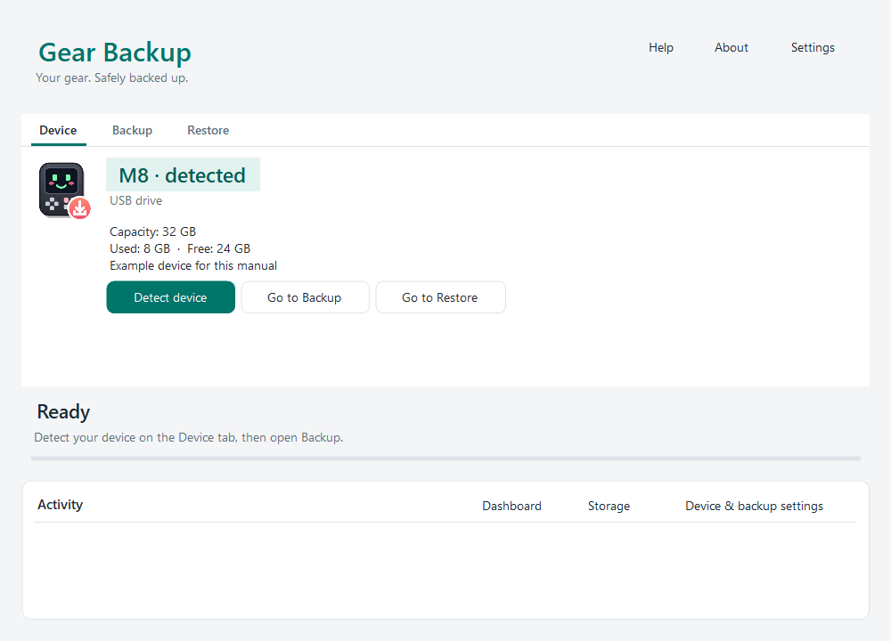
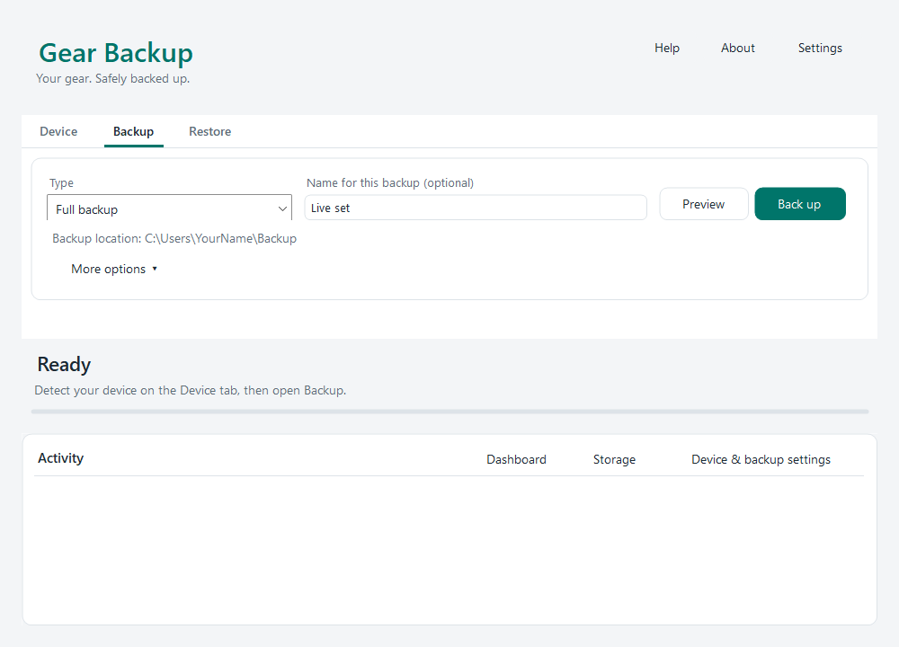
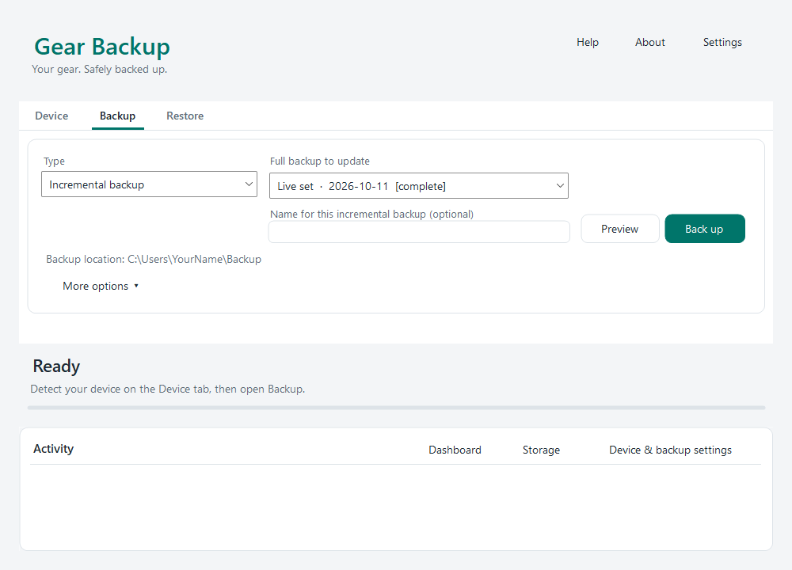
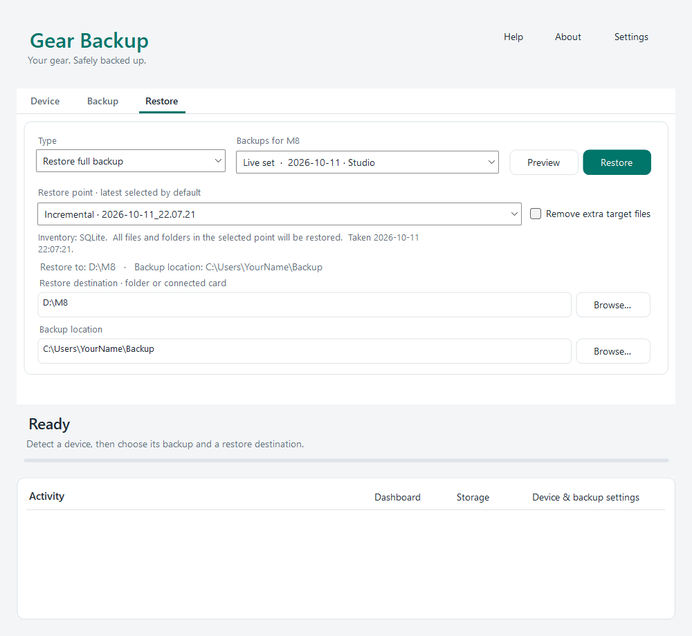
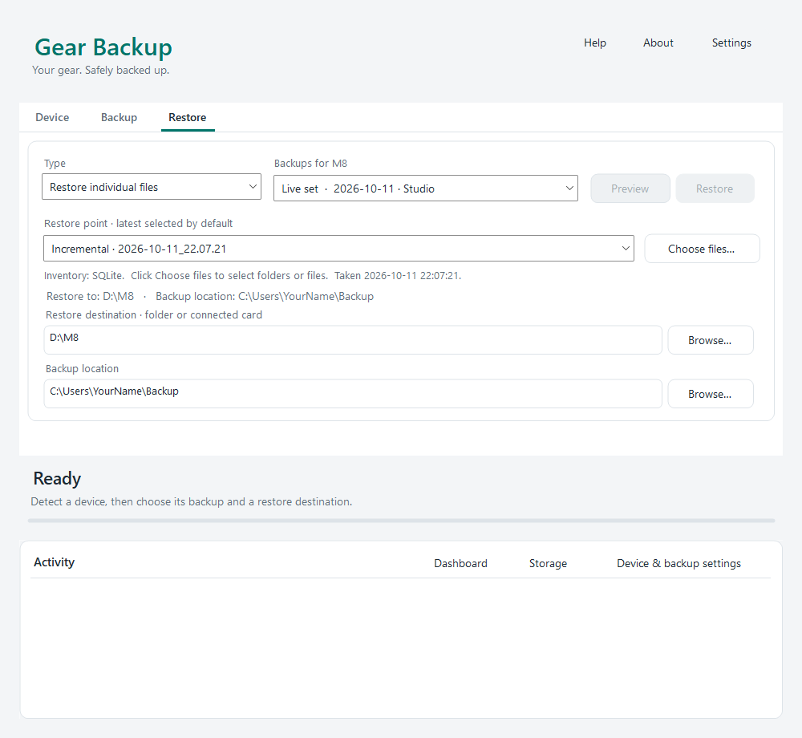
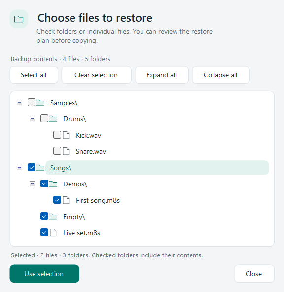
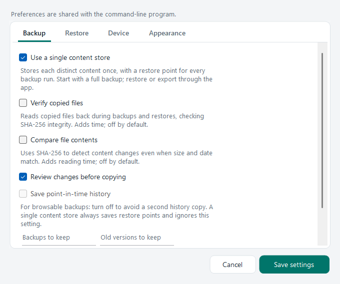

# Gear Backup Manual

A detailed guide to backing up, checking, managing and restoring music gear, camera files and ordinary folders on Windows.

This manual describes Gear Backup 0.9.5, including content-store backups, the M8 Song viewer, standalone ZIP restore and the October 2026 security fixes. The graphical and command-line programs share their backup engines and settings.

## Contents

- [Getting started](#getting-started)
- [Installing and finding your files](#installing-and-finding-your-files)
- [Connecting a device](#connecting-a-device)
- [Histories, backups and restore points](#histories-backups-and-restore-points)
- [Graphical interface](#graphical-interface)
- [Full and incremental backup](#full-and-incremental-backup)
- [How backups are stored](#how-backups-are-stored)
- [Restore](#restore)
- [Checking and managing backups](#checking-and-managing-backups)
- [X100VI settings and recipe viewer](#x100vi-settings-and-recipe-viewer)
- [M8 Song viewer](#m8-song-viewer)
- [M8 card migration](#m8-card-migration)
- [Settings and profiles](#settings-and-profiles)
- [All INI settings](#all-ini-settings)
- [Command line and exit codes](#command-line-and-exit-codes)
- [CLI command reference](#cli-command-reference)
- [CLI switch reference](#cli-switch-reference)
- [CLI examples and operating recipes](#cli-examples-and-operating-recipes)
- [Safety, privacy and limits](#safety-privacy-and-limits)
- [Troubleshooting](#troubleshooting)
- [Building and testing](#building-and-testing)
- [Glossary](#glossary)

## Getting started

### Your first backup

1. Install Gear Backup, or extract the portable package into a writable folder.
2. Open `GearBackup.GUI.exe`. Select the **Gear Backup** icon in the header to use the complete backup interface.
3. Connect your device in its file-transfer mode, insert its memory card into a reader, or prepare a local source folder.
4. Open **Device** and click **Detect device**. Check the reported device and source. For a local folder, choose its source under **More options** on Backup.
5. Open **Backup**, choose **Full backup**, and optionally give this backup a descriptive name.
6. Check the destination. It defaults to `%USERPROFILE%\Backup`; use **More options** to change the backup location. Keep backups on storage separate from the source you are protecting.
7. Click **Preview** to inspect the planned work. Click **Back up** to perform it and approve the change review if enabled. If the backup location does not exist, the app asks before creating it.
8. Wait for the completion summary. Investigate failures before disconnecting the source.
9. Open **Restore** and confirm that the new backup and restore point are available. For extra confidence, restore some files to an empty PC folder and open them with the appropriate application.

The ordinary backup is a content store, not a folder tree containing the original filenames. Use Restore to recover ordinary files. Choose **Zip archive** instead if you want a standalone archive that can also be opened with a ZIP tool.

### A practical routine

After your first full backup, use **Incremental backup** for routine updates. Each successful update adds a complete restore point while storing only content not already present in that set. Make another full backup when you want an independent set, such as a milestone before a tour or a new project phase.

Run **Check backups** periodically and after moving backups to different storage. Keep another independent copy of important backups. A successful copy or checksum check cannot protect the only backup disk from loss or failure.

### Choose an operation

| Goal | Operation |
| --- | --- |
| Start a new independent backup set | Backup → Full backup |
| Save another point in an existing set | Backup → Incremental backup |
| Make one self-contained ZIP without a backup set | Backup → Zip archive |
| Recover a complete saved state | Restore → Restore full backup |
| Recover selected folders or files | Restore → Restore individual files |
| Recover a standalone Gear Backup ZIP | Restore → Restore ZIP archive |
| Read saved content and test its hashes | Restore → Check backups |
| Review backup age and recorded health | Dashboard |
| Review disk usage or remove old sets | Storage |
| Inspect an M8 song's structure and instruments | Song |

## Installing and finding your files

### Requirements and packages

Gear Backup targets Windows 10 or 11 with .NET Framework 4.6 or newer. Reading M8 songs through the bundled native reader requires a 64-bit process. SQLite uses Windows' built-in library; you do not need a database server or separate SQLite installation.

| Package | Behavior |
| --- | --- |
| `GearBackup-Setup-<version>.exe` | Installs for the current Windows user with Start menu shortcuts and an uninstall entry. The standard installation does not require an administrator account. |
| `GearBackup-Portable-<version>.exe` | Extracts the app, libraries and manual into a chosen folder without creating shortcuts, an uninstall entry or a PATH setting. |

The standard installer offers **Create a desktop shortcut** and **Add CLI to PATH**, both initially unchecked. If you enable PATH, open a new terminal afterward; an existing terminal may retain the old environment.

### Application, settings and data locations

| Item | Location |
| --- | --- |
| Default installed application folder | `%LOCALAPPDATA%\Programs\Gear Backup\` |
| Graphical program | `GearBackup.GUI.exe` |
| Command-line program | `GearBackup.exe` |
| Shared application engine | `GearBackup.Core.dll`, beside the programs |
| Native M8 reader | `m8_reader.dll`, beside the GUI |
| Installed global settings | `%APPDATA%\GearBackup\GearBackup.ini` |
| Installed device/history preferences | `%APPDATA%\GearBackup\GearBackup.Profiles.ini` |
| Portable and local-build settings | Beside the executables |
| Default backup location | `%USERPROFILE%\Backup` |
| Histories within that location | `Gear Backups\profiles\` |
| Default recovery location | `<BackupFolder>\Gear Recovery\` |
| Persistent MTP working copies | `%LOCALAPPDATA%\GearBackup\Devices\` |
| ZIP restore extraction workspace | A temporary folder under the Windows temporary directory |

`GearBackup.installed` identifies an installed copy. It reads settings from AppData rather than importing INI files beside the executable. Portable copies keep settings beside their programs, but backups go wherever configured. Moving the portable app does not automatically move its backups or MTP mirrors.

### Updating and uninstalling

Run the new standard installer to update an installed copy. Extract a newer portable package over the existing portable application folder to update that copy. Packages preserve personal INI settings. Keep the programs and matching DLLs together; copying only one EXE can leave an incomplete or incompatible installation.

Uninstalling the standard application removes its installed program components. Backups live at the configured backup location; manage them deliberately through Storage or normal filesystem tools. Identify the role of any settings/data folder before deleting it yourself.

### Opening Help

Click **Help** or press **F1** in the GUI. Help opens the offline HTML manual matching your appearance. `Manual.html` and `Manual-original.html` use Original; the other editions are `Manual-original-dark.html`, `Manual-windows.html` and `Manual-retro.html`. The Windows edition follows the browser's system light/dark preference. Screenshots show Original in every edition.

Keep `assets\manual\` beside the HTML files so illustrations remain available offline. This Markdown file is the source of all HTML editions.

## Connecting a device

### Supported sources

| Device | Source connection | Restore destination |
| --- | --- | --- |
| Dirtywave M8 | USB disk mode, or SD card in a reader | Connected drive/card or PC folder |
| Polyend Tracker Mini | USB drive mode, or SD card in a reader | Connected drive/card or PC folder |
| OP-1 Field | MTP file-transfer mode | PC folder, then manual transfer through Explorer |
| OP-XY | MTP file-transfer mode | PC folder, then manual transfer through Explorer |
| Fujifilm X100VI files | USB file-transfer mode through MTP, or card in a reader | Prefer a PC folder for photos/videos |
| Fujifilm X100VI recipes/settings | USB RAW CONV./BACKUP RESTORE mode | XML exports and readable recipes; no write-back to the camera |
| Ordinary folder | Accessible filesystem source accepted by the path checks | Separate folder or drive |

The existing OP-1 Field transfer workflow is **shift + COM**, then **T4**. For OP-XY, use **COM**, then **T4**. The app reads files exposed over MTP; factory content or other device content not exposed by that interface cannot be included.

### Drives and card readers

A USB disk or memory card has a drive letter, such as `E:\`. Confirm the actual drive before backing up or restoring; Windows can assign another letter on a later connection.

Automatic history identity normally uses the volume serial number for a whole drive. This helps a card retain its history when its drive letter changes. A source folder instead has an identity derived from its full path. Reformatting a card or moving a source folder can therefore resolve to a different automatic history. Set an explicit history name when you want to control that identity.

The Tracker Mini's card marker can identify its type in a reader. For other manually selected cards/folders, set the correct Device value when necessary. An unrecognized source defaults to M8; a folder is not automatically a camera source merely because it contains photos.

### MTP devices and mirrors

MTP devices appear as portable devices in Explorer and do not have an ordinary drive-letter path. Leave the explicit source empty for live detection. Typing an Explorer device display name into Source does not create a usable filesystem path.

Before file backup, the app synchronizes the exposed contents into a persistent PC mirror, then backs up that mirror. New/changed files are downloaded. Stale mirror files are removed when no longer listed by the device. This updates the working mirror, not older restore points in a backup set.

Allow space for both the mirror and backup. A standalone ZIP of an MTP device also needs the mirror. Mirrors are not independent historical backups and should not be edited as your master copy. Storage can remove a mirror; the next backup downloads it again.

Direct MTP restore/upload is not implemented. Recover files into a separate PC folder, inspect them, and use Explorer to transfer the desired files to the device. Choose a restore folder outside the application's mirror.

### Camera modes and detection

For camera files, use file-transfer mode or a card reader. For recipes and shooting settings, use the separate camera-settings operation in USB RAW CONV./BACKUP RESTORE mode. Settings mode is not a normal photo-backup source.

When several supported devices are connected, automatic detection selects one; verify the displayed source. A manual source takes precedence over automatic selection. Close other applications that may hold a device when detection or transfer fails.

## Histories, backups and restore points

| Term | Meaning | Example |
| --- | --- | --- |
| Backup location | Parent folder configured for backup storage | `D:\Backups` |
| History | Sequence of full sets for one source identity or chosen profile | `Studio`, or an automatic card history |
| Full backup set | Independent content store started by Full backup | `2026-10-16` |
| Restore point | Complete file membership recorded by one successful run in a set | Full point followed by incremental points |
| Optional backup name | Display label for a set or incremental point | `Before the tour` |
| History nickname | Readable display name assigned in Dashboard/Storage | `Blue M8 card` |

A full backup starts a new independent set. An incremental adds a complete point within a set. Restore a selected point directly; you do not apply a full copy followed by incremental files in sequence.

**Name for this backup** labels a set. **Name for this incremental backup** labels a point. **History name** under More options controls grouping and corresponds to CLI `--profile`. Renaming a history for display does not rename its folder.

Use distinct history names for sources you want kept separate. Reusing the same explicit name for different sources directs them into the same grouping, so it should be deliberate.

## Graphical interface

### Header modes

The **Gear Backup** icon selects the complete app: Device, Backup and Restore. The M8, Tracker Mini, OP-XY and OP-1 Field header icons select device-specific modes and search for that device type. M8 mode includes **Sample check**, **Card migration** and **Song**; Tracker Mini mode includes **Project inspector** and **Instrument check**; the other devices' **Coming soon** and **Planned** tabs are placeholders. Return to the Gear Backup icon for the normal Backup and Restore tabs.

Detecting a device while in Gear Backup mode keeps the backup tools available. A device-specific placeholder is not an error or a missing installation component.

### Device tab

Click **Detect device** to refresh connection information. Check the type, source, connection and storage details. Shortcuts to Backup and Restore appear in Gear Backup mode. Detection helps select a source; it is not evidence that a backup has completed.



### Backup tab

Choose **Full backup**, **Incremental backup** or **Zip archive**. Its main name/selection field changes with the operation. Expand **More options** for source, backup location, history name and relevant additional options.

**Preview** prepares/displays work without committing the backup plan. **Back up** performs it after the configured review. Standalone ZIP uses a save-location picker instead of creating a content-store set.



### Restore tab

The operation list contains **Restore full backup**, **Restore individual files**, **Restore ZIP archive** and **Check backups**. Set and restore-point selectors apply to content-store restores. ZIP restore instead has an archive picker and matching-device information.

The restore destination is separate from the backup source field. Read its path before approving writes or removals. Without a detected device, content-store backups for all recognized device types can be restored to a PC folder.

### Activity and cancellation

The activity area records decisions, stages and errors. Completion displays a summary, counts and elapsed time, with **Open backup folder**, **Open archive folder** or **Open restore folder** where appropriate. Dashboard, Storage and device/backup preferences are available through the window's tools.

Click **Cancel** and wait for the final status. Closing the main window during an operation requests cancellation first. Completed restore copies remain after cancellation; the entire restore is not rolled back. Interrupted content-store backups can be resumed when offered.

Under **Settings → Appearance**, choose Original, Original (dark), Windows or Retro. Windows follows system app light/dark appearance, accent and supported high-contrast behavior. Theme changes do not affect backup contents.

## Full and incremental backup

### Full backup

1. Choose the source and check the backup location.
2. Select **Full backup**.
3. Optionally name this set. Its label is separate from History name.
4. Preview the plan, or start the backup and review changes.
5. Wait for completion and confirm a full point appears under Restore.

A new full set stores content independently of earlier full sets. Deduplication is within a set, not across all backups. Another full backup can therefore require approximately another source-sized amount of space even when it matches an older set.

### Incremental backup

1. Select **Incremental backup**.
2. Choose **Full backup to update**. The GUI can choose an existing set rather than always updating the newest one.
3. Optionally name the incremental point.
4. Review additions, changes and removed membership.
5. Start the update and wait for completion.



New content is added only when absent from the set. Removing a source file removes it from the new point's membership, but older points can still reference its content. An unchanged successful run still creates a point.

The CLI updates the latest set in the resolved history. Use the GUI to target a different existing set. If a CLI history has no backup yet, its first backup is full even with `Mode=incremental`.

### Comparison and verification

Default comparison uses size and modified time, with the timestamp tolerance needed by FAT filesystems. Files without usable timestamps are compared by bytes. A same-size edit retaining a usable old timestamp can be missed by default comparison.

Enable **Compare file contents** (`Thorough=yes`) for SHA-256 comparison of existing content. Enable **Verify copied files** (`Verify=yes`) for automatic integrity/read-back verification. These are distinct controls:

| Control | Question answered |
| --- | --- |
| Thorough | Does this content differ from the version being compared? |
| Verify | Did copied/stored content pass this operation's automatic integrity checks? |
| Check backups | Does saved content still match the hashes referenced by restore points? |

Hashes are recorded for captured content even with Verify off. Recording hashes alone does not perform optional read-back verification.

### Standalone Zip archive

Choose **Zip archive** for a standalone full archive. Select its save location; the optional ZIP filename supplies a suggestion. No normal history, content-store set or incremental chain is created.

The archive contains original relative paths, empty folders, `checksums.sha256` and `gearbackup-info.txt`. The information file records device profile, capture time, counts and sizes, with identifiers when available. It is covered by the checksum manifest. Extracted size includes generated metadata but excludes filesystem allocation overhead.

The source must not contain top-level files/folders named `checksums.sha256` or `gearbackup-info.txt`; these are reserved metadata names. Save the ZIP outside the source tree. Replacing an existing archive requires confirmation. An interrupted archive is not published as a completed ZIP.

MTP sources are mirrored first. Optional verification reads the archive back after writing; checksum generation itself is always performed.

### Additional ZIP after a full backup

The additional ZIP-copy option, or CLI `--zip`, first creates a full content-store set and then exports its latest point as ordinary files in a ZIP beside the set. It is not applied to incremental runs.

This export includes a checksum manifest, but does not add the standalone `gearbackup-info.txt` required by **Restore ZIP archive**. Extract it with a ZIP tool, or restore from its content-store set. For an archive intended for the app's standalone ZIP restore, use **Zip archive** / `--zip-archive`.

### Interrupted backups and resume

An unfinished latest set can be offered for resume. Keep the source idle and connected while retrying. Resume reuses completed work where possible and publishes a complete point only after capture succeeds.

An existing dated folder does not necessarily mean a completed backup. Do not remove metadata to make an incomplete set look finished. If a set is damaged or unsuitable, start a new full backup and retain another usable copy until the replacement has been checked.

### Deliberately excluded files

The source scan skips common filesystem leftovers: dot-prefixed files/folders, `lost+found`, `FSCK0000.REC`-style fragments, files ending in `~`, `Thumbs.db`, `ehthumbs.db` and `desktop.ini`. Windows system-volume and Recycle Bin folders are excluded from the normal scan.

This is a backup of a supported file tree, not a sector image or forensic copy of everything on a card. Review skips and name warnings when exact accounting matters. Name warnings do not rename files.

## How backups are stored

### Folder layout

With `BackupFolder=D:\Backups` and history `Studio`, a set can look like this:

```text
D:\Backups\
  Gear Backups\
    profiles\
      Studio\
        2026-10-16\
          .gearbackup\
            objects\
            snapshots\
            catalog.sqlite
            current-snapshot.txt
            device.txt
            storage-mode.txt
            status.txt
```

Dated folders may have time or collision suffixes. Prefer labels in the app over assuming one fixed folder spelling.

`objects` stores content-addressed files. `snapshots` records original relative names, sizes, times and hashes for each point. The current-point record identifies the newest completed state. `catalog.sqlite` is a fast, rebuildable inventory for browsing and incremental work.

Do not edit, rename or delete individual objects/manifests: an object can serve several points. When moving or duplicating a set, copy it whole, including hidden `.gearbackup` metadata. Copying visible files alone can omit the actual backup.

### Space and retention

Identical content is stored once per set. Large changed files need new objects; repeated full backups create independent stores. Every point remains until the whole set is removed. There is no individual point-pruning control.

**Backups to keep** counts full sets, not points. Zero keeps all. After successful backups, excess older sets can be offered for recycling. Confirmation is required; changed folders and the latest protected set are refused on revalidation.

Space usage includes objects, metadata, ZIPs, MTP mirrors, recovery copies and Recycle Bin contents. Recycling something may not release space until the bin is emptied.

### Older layouts

The current code supports content stores. Older plain, browsable-folder layouts are not supported for normal restore, incremental update or integrity checking. Start a new full backup. Keep old files for reference or recover ordinary files from them separately; rebuilding their catalog does not convert their format.

## Restore

### Prepare a destination

Choose an existing folder or connected supported drive. An empty PC folder is useful for testing and inspecting files before returning them to a device. Check free space and write access.

The destination cannot be the selected backup, a folder inside it, or an ancestor containing it. Configured backup repositories and recovery storage are protected from content-store restore too. Use a separate folder such as `D:\RestoredFiles`, outside `Gear Backups` and `Gear Recovery`.

### Restore a complete saved point

1. Select the Gear Backup header icon and open **Restore**.
2. Choose **Restore full backup**.
3. Select a set and the desired **Restore point**. The latest point is selected initially.
4. Set the destination and verify its folder and drive letter.
5. Leave **Remove extra target files** unchecked for a merge unless you deliberately need an exact restore.
6. Preview, review replacement decisions, and approve the operation.
7. Check copied/removed/failed counts and open representative restored files.



Each point describes complete membership for its run. Choosing an older point does not remove newer points from the backup.

### Individual files and folders

Select **Restore individual files**, choose a set/point, and click **Choose files…**. Check folders or files in the browser. Folder selection includes contents even when not expanded. Use the summary and Select/Clear controls to confirm the scope.





Individual restore does not enable exact removal of the rest of the target. Select a whole project folder when you need its supporting files, rather than only its project file.

### Merge, replacement and exact restore

| Choice | Effect |
| --- | --- |
| Merge | Restore selected saved files as needed; leave unrelated target content. |
| Replace differing files | Permit saved versions to replace differing target versions. |
| Keep differing files | Copy missing files but keep existing differing ones. Also disables exact removals. |
| Exact saved point | Restore complete membership, then remove scanned extra files and empty folders absent from that point after copying succeeds. |

The GUI's **Remove extra target files** selects exact behavior for a full saved-point restore. The CLI offers Merge/Exact after choosing a historical point and All files. Exact cleanup follows the app's scan exclusions; it does not format the disk or make a sector-level clone.

Newer target files produce a warning. Target fingerprints are rechecked after planning. Replacements are staged before publication. Failed copying prevents exact cleanup from proceeding as if copying succeeded. Completed copies can remain after later failure/cancellation, so read the summary.

### Recovery copies

Enable **Settings → Restore → Keep recovery copies before restoring** to save target files before overwrite/removal. Recovery defaults to off. Its default location is `<BackupFolder>\Gear Recovery`; an explicit RecoveryFolder can use another suitable location.

Recovery copies are prepared before target mutation; failure stops the restore. They require extra space and must be outside the target tree. Keep each dated recovery folder and its metadata together. Recovery preserves previous target content; it is not an independent backup of the source set.

### Offline and replacement-device restore

A content-store restore to a PC folder needs no live device. With none detected, the GUI lists backups for all recognized types. With a device detected, filtering is by type, not one physical serial number. Listings can include locations saved in device/profile preferences.

For MTP-backed devices, recover to a separate PC folder and transfer through Explorer. For camera photos, a PC folder is normally appropriate. Returning old photos to the camera card can conflict with numbering and does not restore camera settings.

### Restore a standalone ZIP

This is a GUI operation; there is no CLI ZIP-restore switch.

1. On Device, detect the destination device. ZIP restore requires detected device-type matching even when the final destination is a PC folder.
2. On Restore, choose **Restore ZIP archive** and select a ZIP. Use **Browse…** to replace the selection.
3. Check its device type, time, counts and sizes. A mismatch blocks restore.
4. Choose an existing PC folder or matching detected drive/card as supported. MTP requires a PC folder outside the mirror.
5. Click Preview or Restore. Structure, metadata and sizes are validated; temporary and destination space is checked. Content is extracted into a temporary workspace and verified before the target restore plan is shown.
6. Review replacements/recovery, approve, and check the final summary.

Both `gearbackup-info.txt` and `checksums.sha256` must be valid. Ordinary ZIPs, manually assembled archives and the additional `--zip` export may not qualify. Opening them in another ZIP tool does not make them compatible standalone Gear Backup archives.

Archive-content verification is mandatory even with `Verify=no`. Restore merges original content and empty folders; generated metadata is not copied into the target and extra target files remain. Temporary extraction is cleaned after completion, cancellation or failure where possible; warnings identify workspace that could not be removed.

A ZIP preview can use temporary disk space but does not modify the restore destination. Requirements are combined when extraction and destination share a volume. Validated sizes exclude allocation overhead, so leave additional free space.

## Checking and managing backups

### Integrity checks

Choose **Check backups** on Restore or CLI `--check`. Pick a history and one set or all its sets. No live device is required.

Checks read saved objects and compare their hashes with restore-point references. Shared content is checked once. Results distinguish good, damaged, missing and unchecked content where applicable. Recorded results and the rebuildable catalog support Dashboard and Storage views.

A check detects damage; it cannot reconstruct bytes. Preserve the source and other copies when failures occur. Identify affected files and recover from a usable copy. A catalog rebuild repairs an index, not damaged content. Do not replace checksum baselines merely to silence an error.

Read the summary alongside exit codes and status. An unsupported older set can be reported as not checked; that does not establish that its contents are healthy.

### Dashboard

Dashboard provides history/set completion information, age, sizes and recorded integrity results. Use its device filter to narrow the view. **Rename…** assigns a history nickname without changing its folder identity. **View recipes** is available for supported X100VI settings backups.

Recorded health reflects the previous check/state, not continuous monitoring. Run a fresh check after a disk incident or when you need current evidence.

### Storage and cleanup

Storage separates space usage from cleanup. Its device filter applies to both. Read each row's location and removal consequence before selecting it.

- Removing an old full set removes every point in that set.
- Removing a ZIP removes that archive copy.
- Removing an MTP mirror discards a working cache; the device is downloaded again on the next backup.

Cleanup previews/revalidates paths and protects the latest set in each history. Items go to the Recycle Bin where supported. Emptying it is a separate Windows action. Confirm another recoverable copy before removing data just because it occupies significant space.

### Moving backups and repairing a catalog

Stop operations before moving storage. Copy complete sets/histories, including hidden metadata. Update global and device/profile locations pointing at the old storage. Check the new copy and test restore before deleting the original.

The SQLite catalog indexes manifests and stored content. The app can fall back to recovery records when it is missing, stale or damaged and can rebuild it. Explicit repair takes one dated set folder:

```powershell
.\GearBackup.exe --rebuild-catalog "D:\Backups\Gear Backups\profiles\Studio\2026-10-16" --no-pause
```

Pass neither the repository root nor `catalog.sqlite` itself. A rebuild does not repair missing objects, convert old layouts or prove authenticity.

## X100VI settings and recipe viewer

### Capturing settings

Connect exactly one X100VI in **USB RAW CONV./BACKUP RESTORE** mode and close competing camera software. Choose the camera-settings backup operation in the GUI when available for the detected camera, or run:

```powershell
.\GearBackup.exe --camera-settings --no-pause
```

The app captures C1–C7 recipes and current shooting settings as XML exports in a separate settings history. An explicit history such as Studio uses a corresponding name ending in `-settings`; automatic histories also separate settings from photos.

This is a settings snapshot, not a complete camera configuration image or Fujifilm X Acquire backup. The protocol temporarily selects recipe banks for reading and restores the selector. It does not offer editing or upload of saved settings to the camera. Leave the camera idle until capture finishes.

### Reading and exporting recipes

Choose **View recipes** for a supported settings backup in Dashboard/Storage. The viewer can also open an XML export or a folder of exports. It displays recognized film simulation names and values; unknown values remain explicit protocol values instead of guesses.

Use copy/export actions to make a readable text reference. A text report is for reading or applying settings manually, not uploading to the camera. Restore XML files to a PC folder when you need separate copies of their exports.

## Tracker Mini project tools

Choose the **Tracker Mini** icon in the header. Its two tabs read a project without changing anything.

**Project inspector.** Choose the Tracker card (or a project folder that holds `project.mt`) with **Browse…** and click **Inspect**. If the card holds several projects, pick one from the list that appears. The tab shows the project name, tempo and firmware, how many patterns and song positions it has, every instrument file with its sample name, length, channels and play mode, and every pattern with the instruments its notes play and whether the song uses it.

**Pattern viewer.** Select a pattern in the inspector and click **View pattern** (or double-click it) to see its steps: a row per step and a column per track that has anything in it, with the note, the instrument and up to two effects in each cell, for example `C4 03 V80`. Notes use MIDI note names (60 is C4). Instruments `01`-`48` are sample instruments, `M1`-`M16` MIDI and `S1`-`S3` synth engines. Effects show their symbol and value as the Tracker does, for example `T120` for a tempo of 120.

**Device tab.** When a Tracker Mini card is detected, the Device tab also lists how many projects the card holds, the newest one, and the projects that need attention (instruments played without a usable file, unreadable files, song positions without a pattern). Up to 25 projects, newest first, are checked this way; open the tabs for the full detail.

**Instrument check.** A Tracker instrument keeps its sample inside its `.pti` file and a project stores no sample paths, so there is no path to go missing as on the M8. What can go wrong is that a pattern plays an instrument number that has no usable instrument file. The check lists each such instrument (no file, unreadable, or a file with no audio), the patterns that play it and whether any of them is in the song. It also notes song positions that have no pattern file (usually just an empty pattern), and counts MIDI and synth instruments, which have no files. Click **Check project** to read the project again after fixing it.

Only notes inside a track's length count, and instruments are matched by number: a note on instrument 7 needs the file for slot 7, named `7 <sample>.pti` on a Tracker Mini card. Projects made on the original Tracker keep `instrument_07.mti` settings files and the audio in `samples\instr07.wav`; the check looks for that wav file too. The file layouts follow Polyend's open-source tracker-lib; if a project from a newer firmware reads oddly, tell us which file so the reader can be checked against it.

## M8 Song viewer

Choose the **M8** icon in the header, open **Song**, browse to a Dirtywave M8 `.m8s` file, and wait for the summary. It can be read from a source card, ordinary folder or restored copy. Restore a song to an ordinary folder first if it is only available as a content-store object.

The view includes available song name, firmware, tempo, transpose, quantize, song length, used rows per track, chain/phrase/table counts, and instruments with slot, type, name and sample reference.

The viewer reads files; it does not play, edit or save songs. A sample reference does not prove the sample exists beside the song. CLI **Song with dependent samples** is a separate restore feature with firmware/layout restrictions.

The viewer uses `m8_reader.dll`. Reinstall/re-extract the matching package if it is missing or incompatible; do not obtain an unrelated DLL. Damaged, truncated or oversized inputs are refused/reported. A 64-bit application process is required.

### Check M8 sample dependencies

In builds containing the Sample check feature, select the **M8** header icon, then **Sample check**. No connected device is required.

1. Choose the `.m8s` song to inspect. For a song stored in a backup, restore it to an ordinary folder first.
2. Choose the **M8 card root** or an extracted copy of the whole card. For `/Samples/kick.wav`, select the folder containing `Samples`, not `Samples` itself or the song's directory. Leave this field empty for a backup-only search.
3. Leave **Search M8 backup histories** enabled to search saved copies. The backup location defaults to the application's settings; change it to another backup location if necessary. Configured device/history backup locations are also searched. Clear the checkbox for a card-only check.
4. Choose **Check samples**. **Cancel** stops a check; rerun it for complete results.
5. Select a reference in the upper table to see backup matches in the lower table. Scroll the tab to reach results and warnings on smaller windows.

Turning **Search M8 backup histories** off hides backup matches while retaining card results. Turning it back on automatically refreshes history for the current song. In the whole-card list, it searches the selected readable song without clearing the list; selecting another song while search is enabled refreshes that song's history. The whole-card scan itself still checks only the card.

References are grouped without regard to case, with all referencing instrument slots listed in hexadecimal. Every sampler slot exposed by the song reader is included, even if the song does not use that instrument. **Present on card** means the referenced file can be opened; it does not validate the audio format or establish that it is the intended sample. **Missing on card**, **Cannot check card**, **Invalid reference** and **Card not checked** distinguish absence from other conditions. Unsafe paths and links are refused.

Paths beginning with `/` (for example `/Samples/kick.wav`) start at the card root. Paths without it (for example `Samples/kick.wav`) start beside the actual song file: a song in `Songs\Demos` uses `Songs\Demos\Samples\kick.wav`. The song's embedded saved directory may be outdated and is not used to override its actual location. Hover over a sample reference to see the resolved card-relative path. For relative references, choose a song located within the selected card root or extracted card tree; otherwise **Cannot resolve reference** explains that more location context is needed. Absolute references can still be searched without a card.

Backup searches include older saved restore points in M8 histories. **Exact path** matches retain the referenced card-relative path; **Filename only** matches are possible copies stored elsewhere. Neither establishes which historical sample version the song intended. Each matching content object is checked against its saved size and SHA-256 hash; damaged or missing objects are marked **Unavailable / damaged**. Checksums establish consistency with backup records, not authorship. Results show the backup folder, restore point and original path. Up to 100 matches are shown per reference, prioritizing exact paths; warnings identify truncation and unreadable sets.

To recover a copy, double-click its row in the lower table and confirm **Restore sample**. The normal **Restore individual files** interface opens with that backup, saved point and sample preselected. Review the destination, then click **Restore**; double-clicking does not copy files immediately. Filename-only candidates retain their original folder path, which may differ from the song's reference. Unavailable or damaged copies cannot use this shortcut. You can also select the **Gear Backup** header icon and choose the set, point and file manually. Review warnings before concluding that no copy exists; unavailable locations and unreadable backups can leave the search incomplete. Editing inputs clears previous results.

### Check every song on an M8 card

Select the **M8** header icon, open **Sample check**, and choose the **M8 card root**. Click **Check all songs on card**. You do not need to choose a song first. This operation recursively finds `.m8s` files, including songs in bundles and subfolders, then checks their sample references against that same card root. It checks the card only, regardless of the backup-search checkbox.

The song table lists each song's card-relative path, number of unique references, missing-reference count and result. The summary gives the number of songs with missing samples and the number needing attention. Unreadable songs and invalid or inaccessible references are reported separately; they are not treated as successfully checked. Songs without sample references are also listed. All exposed sampler slots are included, even unused ones.

Select a song row to see its sample paths and individual availability below. Double-click a song row to open its individual check, using the current backup-search setting; use that workflow to find and recover saved sample copies. **Cancel** stops the scan without modifying files. Rerun after cancellation for complete results.

Links/junctions are skipped with warnings, and unreadable folders can leave the scan incomplete. Standard Windows `System Volume Information` and `$RECYCLE.BIN` directories are excluded. A scan is bounded to 10,000 songs and 1,000,000 filesystem entries; reaching either limit produces a visible incomplete-scan warning. Presence checks do not validate audio contents or establish that a sample is the intended version.

## M8 card migration

In builds containing this feature, select the **M8** header icon and open **Card migration**. The assistant copies a complete restore point from an existing M8 content-store backup to an empty replacement card or test folder, verifies the restored files, then checks the restored songs for sample dependencies. A connected original M8 is not required.

1. Prepare a replacement card for your M8 separately, or create an empty PC folder for a rehearsal. The assistant does not partition or format storage, flash firmware, or test the card's hardware compatibility.
2. Choose the **Backup location** and click **Refresh backups**. The list includes M8 histories in that location and configured device/history locations.
3. Choose the **M8 backup set** and **Complete restore point**. The latest saved point is selected initially; you can choose an older one. The summary shows its file count and size. The backup must have a completed status and contain files.
4. Browse to the **Replacement card root / empty test folder**. Choose the card root to preserve the M8 folder layout. The destination must already exist and be empty. Standard Windows `System Volume Information` and `$RECYCLE.BIN` directories are tolerated at a drive root; other existing items are refused. To merge into a card containing files, use the ordinary Restore workflow.
5. Optionally check **Link replacement card to the original backup history** before clicking **Migrate and verify…**. Linking requires a card drive root with a readable volume ID; leave it unchecked for a test folder. Source checksums, safe paths and available working space are checked before copying. Review the preview, which identifies the destination, then choose **Proceed**. Refusing the preview leaves the destination unchanged.
6. Wait for copying, full file verification and song checks to finish. Progress and **Cancel** appear in the activity area while the operation runs.
7. Review the summary, song-results table and detailed report. Choose **Save report…** to keep a text record. Scroll the tab if the results extend below the window. Safely eject the replacement card through Windows after completion before removing it.

Migration always enables source/copy checksum checks, content comparison and copy-plan review, regardless of the ordinary Verify, Thorough and Preview preferences. It does not change those saved preferences. After the restore, every expected file is checked against the selected point's recorded size and SHA-256 hash, and expected folders are checked for presence. The destination's directory/volume identity is revalidated after approval and during completion checks. Backup and recovery storage overlaps, links, changed points and non-M8 backups are refused.

The final song scan uses the same path rules as Sample check, including song-relative demo/bundle samples and unused sampler slots. A backup may copy correctly yet already contain songs with missing references; these are reported as **needs attention**, rather than a fully successful migration. Unreadable songs, invalid references, file-verification failures and incomplete song scans also need attention. The detailed report lists affected songs and references. This verifies captured file contents and dependencies; it does not guarantee that the M8 will play every file.

When linking is selected, the association is saved only after copying, verification and song checks succeed. Future full and incremental backups of that card use the selected backup's original history, backup location and profile preferences. Existing restore points remain available. The association uses the replacement card's volume ID, so a different drive letter or reader does not change it. An explicit Profile/History name overrides automatic linking. A conflicting existing association is refused. If the original backup storage is unavailable, backup stops rather than starting a separate history.

Links are stored in `GearBackup.CardLinks.ini` beside the application's settings (the installed settings directory or portable application directory). Keep that file when moving settings to another PC; it contains the original history's absolute path, which must remain accessible. The migration report states whether a link was saved. Failed, cancelled or needs-attention migrations leave associations unchanged; a link-save failure is reported as needs attention even when the files migrated correctly. Leaving the checkbox off retains normal independent card histories. Old backups can still be restored without linking.

Cancellation is not a rollback. Files copied before cancellation or failure can remain, and final verification/dependency checks may be incomplete. Use ordinary Restore to continue into that partially populated destination, or choose a different empty destination for a fresh migration. The assistant never removes existing content to make a destination empty, edits song paths, or automatically ejects the card.

## Settings and profiles

### Global preferences

GUI and CLI share settings. Use **Settings** for backup, restore, device and appearance preferences. Some choices, including CLI Mode and Device for manual sources, are INI settings rather than command-line switches.



Defaults are `Preview=yes`, `Verify=no`, `Thorough=no`, `Recovery=no`, `KeepBackups=0` and `Eject=no`. Enable verification, content comparison and recovery deliberately and allow their extra disk/time requirements.

### Device and history overrides

**Device & backup settings** saves overrides in `GearBackup.Profiles.ini`. Supported preferences are resolved in this order:

1. Global `GearBackup.ini` values.
2. Device defaults, such as `[device:m8]`.
3. Resolved history preferences, such as `[profile:Studio]`.

**Use default** inherits instead of keeping an explicit override. A device-specific BackupFolder can explain a destination differing from the global setting. Restore resolves preferences using the selected backup's recorded device/history.

Example override file:

```ini
[device:m8]
Verify=yes
BackupFolder=D:\Music Backups

[profile:Studio]
Thorough=yes
Recovery=yes
RecoveryFolder=D:\Restore Recovery
KeepBackups=4
```

Only supported preference keys belong in override sections. Do not put `Mode`, `SourceFolder`, `Profile`, `Device` or `Theme` there. Unsupported sections/keys are errors. Prefer the GUI editor when unsure.

### Editing the global INI

Close the application before manual edits. Use one `Key=value` per line. Lines beginning with `;` or `#` are comments. Boolean settings recognize `yes/no`, `true/false`, `1/0` and `on/off`; use the documented spellings for clarity.

Configured paths expand environment variables, for example `BackupFolder=%USERPROFILE%\Backup`. An empty BackupFolder uses the default on load. Other empty-value behavior is listed below.

Ordinary loading appends missing global keys with documentation/defaults. CLI `--preview` suppresses that update. Unknown global keys are ignored, while unknown CLI switches are rejected. Inspect warnings/errors after editing recognized values.

## All INI settings

These are all global keys in the current implementation. **Override** indicates availability in Device & backup settings. `<BackupFolder>` means the effective preference for the operation.

| Key | Default | Values / meaning | Override |
| --- | --- | --- | --- |
| `Theme` | `original` | `original`, `original-dark`, `windows`, `retro`; GUI and Help appearance | No |
| `BackupFolder` | `%USERPROFILE%\Backup` | Parent storage location; blank uses default on load; environment variables supported | Yes |
| `Verify` | `no` | Read-back and automatic integrity checks for applicable copy, restore, stored-content and recovery work | Yes |
| `Thorough` | `no` | SHA-256 content comparison instead of size/usable timestamp | Yes |
| `Preview` | `yes` | Detailed review/approval before normal backup/restore; distinct from CLI `--preview` | Yes |
| `KeepBackups` | `0` | Nonnegative full-set retention count; `0` keeps all; removals require confirmation | Yes |
| `Recovery` | `no` | Save target files before restore overwrite/removal | Yes |
| `RecoveryFolder` | Empty | Blank uses `<BackupFolder>\Gear Recovery`; otherwise explicit recovery path | Yes |
| `MaxNameLength` | `64` | Applicable device-name warning threshold; `0` disables length warnings | Yes |
| `Eject` | `no` | `no`, `ask`, `yes`; supported detected USB-drive device ejection after applicable operations | Yes |
| `Mode` | `ask` | CLI backup behavior: `ask`, `full`, `incremental` | No |
| `SourceFolder` | Empty | Explicit source, or CLI restore target; blank permits detection/manual entry | No |
| `Profile` | Empty | Explicit history grouping; blank uses automatic source identity | No |
| `Device` | `auto` | `auto`, `m8`, `op1-field`, `op-xy`, `tracker-mini`, `x100vi` | No |

`Zip` is not a saved global INI key. Additional-ZIP selection is per invocation. Point/set display names and selected restore points are not persistent global keys either.

Removed settings such as `SingleContentStore`, `PointInTimeHistory`, `HardLinks` and `KeepOldVersions` do not re-enable the previous browsable format.

### Example global configuration

This enables content comparisons, verification and recovery while retaining interactive review:

```ini
Theme=original
BackupFolder=D:\Backups
Verify=yes
Thorough=yes
Preview=yes
KeepBackups=0
Recovery=yes
RecoveryFolder=D:\Restore Recovery
MaxNameLength=64
Eject=no
Mode=ask
SourceFolder=
Profile=
Device=auto
```

A source-specific Device or SourceFolder changes the next operation too. Clear SourceFolder for live MTP detection and reset Device when returning to mixed-device use.

## Command line and exit codes

### Starting the program

PowerShell examples below assume the executable folder is current. PowerShell uses `.\GearBackup.exe` to run the local file. With the installer PATH option enabled, run `GearBackup.exe` by name from a newly opened terminal instead.

Without PATH, PowerShell's call operator runs an installed program at a quoted path:

```powershell
& "$env:LOCALAPPDATA\Programs\Gear Backup\GearBackup.exe" --check --no-pause
```

Quote spaces and supply values as separate arguments: `--profile "Live rig"`. There are no `--key=value` forms, short aliases, positional source arguments, `--help` or `--version` switches.

### Command forms

```text
GearBackup.exe [--source PATH] [--profile NAME] [--zip] [--preview] [--no-pause]
GearBackup.exe --restore [--source TARGET] [--profile NAME] [--preview] [--no-pause]
GearBackup.exe --check [--profile NAME] [--preview] [--no-pause]
GearBackup.exe --camera-settings [--profile NAME] [--zip] [--preview] [--no-pause]
GearBackup.exe --zip-archive [--source PATH] [--profile NAME] [--output PATH] [--name NAME] [--preview] [--no-pause]
GearBackup.exe --rebuild-catalog BACKUP_FOLDER [--preview] [--no-pause]
```

Brackets indicate optional arguments; do not type them. These are operation switches, not subcommands. Running without an operation switch starts the normal source/backup flow. Switches do not replace every interactive choice.

### Complete switch index

| Switch | Value | Purpose |
| --- | --- | --- |
| `--restore` | None | Restore content-store backups |
| `--check` | None | Check saved backups without a source device |
| `--camera-settings` | None | Capture X100VI recipes/shooting settings |
| `--zip-archive` | None | Create a standalone full ZIP |
| `--rebuild-catalog` | Set folder | Rebuild one set's SQLite index |
| `--source` | Folder/drive | Backup source, or target for Restore |
| `--profile` | History name | Set history grouping for the invocation |
| `--zip` | None | Also export ZIP after an applicable full backup |
| `--output` | ZIP filename or existing folder | Standalone ZIP destination |
| `--name` | Suggested ZIP name | Standalone ZIP naming suggestion |
| `--preview` | None | Preview rather than commit the operation |
| `--no-pause` | None | Suppress final exit-key wait |

These are all 12 supported switches. Each has syntax, an example and restrictions in the [switch reference](#cli-switch-reference).

### Exit codes

| Code | Interpretation |
| --- | --- |
| `0` | Completed, previewed, declined or cancelled without reported operational failure. Read the summary to distinguish them. |
| `1` | Invalid input, missing prerequisite, exception or other workflow failure. |
| `2` | Reported failed work, such as failed restore files, failed additional ZIP export, or damaged/missing content found by checking. |

There is no distinct cancellation code. Zero alone does not prove a scheduled backup was written. Inspect output and backup state. A check reporting unsupported sets as unchecked does not establish their health either.

Press **Ctrl+C** to request cancellation and wait before disconnecting storage. `--no-pause` removes only the final wait; it does not answer source, mode, overwrite, retention or review questions.

## CLI command reference

### Normal backup and interactive choices

```powershell
.\GearBackup.exe --source "E:\" --no-pause
```

The CLI loads settings, resolves source/device/history preferences, and chooses backup behavior. `--source` overrides saved SourceFolder. With neither set, detection is attempted and manual entry is offered if detection fails.

With a previous set and `Mode=ask`, choose Full, Incremental and applicable Restore/Check options. MTP does not offer direct device restore. `Mode=full` starts a new set; `Mode=incremental` updates the latest set. A first full backup is possible when none exists. An unfinished latest set can trigger resume.

There are no `--full` or `--incremental` flags. Use Mode or the menu. Choosing an older incremental target and naming ordinary full/incremental points are GUI features.

### Content-store restore

```powershell
.\GearBackup.exe --restore --source "D:\RestoredFiles" --profile "Studio" --no-pause
```

Create the target first. Here `--source` is the **destination**, not the saved backup. Choose a history/set, point and supported scope interactively. Profile is grouping/preference context, not a selector for one dated set.

Scopes depend on the saved device:

- **All files:** complete chosen inventory.
- **Bundle:** an M8 bundle with its contents.
- **Whole project folder:** a Tracker project and supporting files.
- **Single file:** filename search and selection.
- **Song with dependent samples:** supported M8 song and its referenced samples.

In file search, Enter lists recognized songs/projects, typed search finds matching filenames, and `q` cancels. M8 song-with-samples extraction supports the firmware-6 layout. For unsupported layouts, use bundle/full restore or choose files separately. Samples referenced by unused sampler slots are included. Missing references block a supposedly complete dependency restore.

The exact choice is offered for All files from a historical point. Replacement decisions, recovery and target protection remain. For MTP histories, specify a PC folder; an automatically detected MTP source is not writable by restore.

### Check saved backups

```powershell
.\GearBackup.exe --check --profile "Studio" --no-pause
```

Choose one set or all sets in the history. Without Profile, choose a history across configured locations. An explicit profile addresses that exact history folder name; multiple matching locations produce a location choice.

`--source` is not used to select what is checked. A live device is unnecessary. `--check --preview` explains that no check is performed and exits; omit preview for a real check.

### Capture X100VI settings

```powershell
.\GearBackup.exe --camera-settings --profile "Camera" --no-pause
```

Connect exactly one camera in the required settings mode. The command saves a full settings snapshot in its separate history, rather than incrementally updating a photo backup according to Mode. `--zip` can add the full-backup ZIP export; it does not enable settings restoration.

Do not pass Source. Profile preferences can control storage/verification. Even preview needs camera communication and preparation of temporary settings data before the plan is available.

### Create a standalone archive

```powershell
.\GearBackup.exe --zip-archive --source "D:\M8Card" --output "D:\Archives" --name "Live set" --no-pause
```

The output directory must already exist. A directory receives the suggested filename; an explicit `.zip` output fixes the name directly. Omitted output prompts for a path; blank cancels.

The default suggestion combines device name and current date/time. A supplied name is limited to 80 characters, rejects controls and is normalized by the archive naming logic. An explicit output file takes precedence over the suggestion.

This always makes a full standalone ZIP, regardless of Mode. It cannot be combined with another operation or `--zip`. It records device metadata and checksum coverage, preserves empty folders, and must be saved outside the source.

### Rebuild a catalog

```powershell
.\GearBackup.exe --rebuild-catalog "D:\Backups\Gear Backups\profiles\Studio\2026-10-16" --no-pause
```

Pass an existing current-format set folder. The parent history is locked while the index is rebuilt/published from existing records. Preview prints the intended action without writing the catalog.

Only `--preview` and `--no-pause` may accompany it. Do not add Source, Profile, Zip or another operation. It is not content repair or format conversion.

## CLI switch reference

### --restore

**Syntax:** `--restore`

Select content-store restore rather than normal backup. Supply the target with Source or the source-selection flow. History/set/point selection remains interactive. Mode does not force a backup when Restore is explicit.

```powershell
.\GearBackup.exe --restore --source "D:\RestoredFiles" --preview --no-pause
```

Cannot accompany `--check`, `--camera-settings`, `--zip-archive`, `--rebuild-catalog` or `--zip`. ZIP archive restore is GUI-only.

### --check

**Syntax:** `--check`

Read saved content-store backups and report integrity. Profile can identify a history; otherwise choose one. A source is not needed or used for selection. Preview skips the check.

```powershell
.\GearBackup.exe --check --no-pause
```

Cannot accompany `--restore`, `--camera-settings`, `--zip-archive`, `--rebuild-catalog` or `--zip`.

### --camera-settings

**Syntax:** `--camera-settings`

Capture X100VI C1–C7 recipes/current shooting settings in settings mode. Detects the camera rather than accepting a filesystem source.

```powershell
.\GearBackup.exe --camera-settings --profile "Travel camera" --preview --no-pause
```

Cannot accompany `--source`, `--restore`, `--check`, `--zip-archive` or `--rebuild-catalog`. `--zip` can add a full-backup ZIP export.

### --zip-archive

**Syntax:** `--zip-archive`

Create a standalone full ZIP without a content-store set. Use Output and optionally Name; omitted Output prompts. Mode does not make it incremental.

```powershell
.\GearBackup.exe --zip-archive --source "E:\" --output "D:\Archives\Card backup.zip" --no-pause
```

Cannot accompany Restore, Check, camera settings, catalog rebuild or `--zip`.

### --rebuild-catalog

**Syntax:** `--rebuild-catalog BACKUP_FOLDER`

Rebuild one set's catalog. Pass the dated set folder, not a card, repository root or SQLite filename.

```powershell
.\GearBackup.exe --rebuild-catalog "D:\Backups\Gear Backups\profiles\Studio\2026-10-16" --preview --no-pause
```

Only `--preview` and `--no-pause` are permitted companion switches.

### --source

**Syntax:** `--source PATH`

Override SourceFolder for this invocation. In backup/archive workflows PATH is the source; with Restore it is the destination. Supply an existing accessible drive/folder and quote spaces. Path expansion recognizes supported environment variables.

```powershell
.\GearBackup.exe --source "D:\Music Projects\M8Card" --profile "Studio" --preview --no-pause
```

This is neither a device-type option nor a saved-set selector. Do not use an MTP Explorer display name. It is refused with camera settings/catalog rebuild and has no selection role with Check. It does not save a new global SourceFolder.

### --profile

**Syntax:** `--profile NAME`

Set the history grouping for this invocation. A name starts with an ASCII letter/digit, is 1–64 characters long, and contains only ASCII letters, digits, spaces, `-` or `_`. Trailing spaces and reserved Windows names are refused.

```powershell
.\GearBackup.exe --check --profile "Live rig 1" --no-pause
```

It does not label one full set or point. Camera-settings names have a settings distinction. For standalone ZIP it supplies profile context/preferences and metadata without creating a normal history. Catalog rebuild refuses Profile. The override does not save a global Profile value.

### --zip

**Syntax:** `--zip`

After an applicable full content-store backup, also export its current contents to ZIP beside the set. It does not force Full mode. Incremental runs report that the extra ZIP is not made.

```powershell
.\GearBackup.exe --source "E:\" --profile "Studio" --zip --no-pause
```

Choose Full in the menu or set `Mode=full` for the extra ZIP. Allowed with camera-settings full backup; refused with Restore, Check, standalone ZIP or catalog rebuild. Its export differs from the standalone format accepted by GUI ZIP restore.

### --output

**Syntax:** `--output PATH`

Only valid with `--zip-archive`. PATH is an existing directory or a filename ending in `.zip`. A file's parent must exist. A directory receives the suggested archive name.

```powershell
.\GearBackup.exe --zip-archive --source "D:\M8Card" --output "D:\Archives\Before tour.zip" --no-pause
```

This does not set the normal content-store backup location; use BackupFolder for that. Replacing an existing archive still asks for confirmation.

### --name

**Syntax:** `--name NAME`

Only valid with `--zip-archive`. Suggests a filename when Output is a directory or prompted interactively. It does not override an explicit `.zip` path. Naming logic supplies the extension and normalizes filename characters. Input is limited to 80 characters and cannot contain controls.

```powershell
.\GearBackup.exe --zip-archive --source "D:\M8Card" --output "D:\Archives" --name "Rehearsal 01" --no-pause
```

Ordinary full/incremental point names are GUI fields, not a use of this flag.

### --preview

**Syntax:** `--preview`

Prepare/show work without committing the selected backup/restore plan. This differs from `Preview=yes`, which reviews and can continue after approval. It also suppresses normal settings-file default-key updates.

```powershell
.\GearBackup.exe --source "E:\" --profile "Studio" --preview --no-pause
```

Preview is not a promise of zero filesystem/device activity. Source preparation can create/synchronize an MTP mirror, including removing stale mirror files. Camera-settings preview communicates with the camera, temporarily selects read banks and prepares temporary exports. GUI ZIP restore preview extracts temporary files for verification. The target backup/restore plan is not committed. Catalog preview prints the intended action; Check preview skips checking entirely.

### --no-pause

**Syntax:** `--no-pause`

Suppress the final “Press any key to exit” wait. Useful from an existing terminal or when collecting an exit code.

```powershell
.\GearBackup.exe --check --profile "Studio" --no-pause
```

It does not make an operation unattended, choose a menu item or approve changes. It can accompany any workflow. Cancellation also suppresses the usual final pause.

### Invalid combinations and unavailable flags

| Request | What to do |
| --- | --- |
| `--restore --check` | Use separate workflows. |
| `--zip-archive --zip` | Choose standalone ZIP or a full set with an extra export. |
| Output/Name without standalone ZIP | Use `--zip-archive`, or configure BackupFolder for normal backup storage. |
| `--camera-settings --source ...` | Detect the camera in its settings mode. |
| Catalog rebuild with Profile or Source | Supply only the exact set folder and optional Preview/No-pause. |
| `--full`, `--incremental`, `--verify`, `--thorough`, `--device`, `--backup-folder` | Not implemented; use the supported INI setting where applicable or the mode menu. |
| `--yes`, `--force`, `--silent`, `--no-preview` | Not implemented; normal confirmation/safety rules remain. |
| `--restore-zip`, `--help`, `--version`, `-h`, `-?` | Not implemented; use GUI ZIP restore, this reference, and About/package metadata as appropriate. |

Do not reuse undocumented switches from another backup program. Unknown arguments are errors.

## CLI examples and operating recipes

### Detect a connected source

Leave SourceFolder empty, then run:

```powershell
.\GearBackup.exe --no-pause
```

Choose the intended mode. For MTP, omit an explicit source and allow mirror space.

### Preview a named local history

```powershell
.\GearBackup.exe --source "D:\M8Card" --profile "Studio" --preview --no-pause
```

This previews the normal backup mode selected by settings/menu. Studio groups the history; it is not a point display name.

### Always create a new full set

Set the needed keys in the shared INI:

```ini
Mode=full
Preview=yes
Verify=yes
```

Then run:

```powershell
.\GearBackup.exe --source "E:\" --profile "Studio" --no-pause
```

The mode menu is avoided, but review, resume, location-creation and retention questions may remain. Restore `Mode=ask` for future interactive mode choices.

### Incrementally update the latest set

Set `Mode=incremental`, then run:

```powershell
.\GearBackup.exe --source "E:\" --profile "Studio" --no-pause
```

The latest Studio set is updated; a first full backup is made if none exists. Set `Thorough=yes` when same-size/same-timestamp edits must be detected by content. Use the GUI to choose another incremental target.

### Create standalone archives

Create the output directory if needed:

```powershell
New-Item -ItemType Directory -Path "D:\Archives" -Force
.\GearBackup.exe --zip-archive --source "D:\M8Card" --output "D:\Archives\Studio before tour.zip" --no-pause
```

For an automatically suggested timestamped filename, give only the existing folder:

```powershell
.\GearBackup.exe --zip-archive --source "D:\M8Card" --output "D:\Archives" --no-pause
```

For an interactive output prompt with a suggested name:

```powershell
.\GearBackup.exe --zip-archive --source "D:\M8Card" --name "Studio archive" --no-pause
```

### Recover without the original device

```powershell
New-Item -ItemType Directory -Path "D:\RestoredFiles" -Force
.\GearBackup.exe --restore --source "D:\RestoredFiles" --profile "Studio" --no-pause
```

Select history/set/point and scope. Merge is the conservative starting point for an existing target. Preview first with:

```powershell
.\GearBackup.exe --restore --source "D:\RestoredFiles" --profile "Studio" --preview --no-pause
```

For OP-1 Field/OP-XY, inspect the recovered PC files before manually transferring them through Explorer. A failed device does not prevent restoring a valid saved set.

### Check and preview catalog repair

```powershell
.\GearBackup.exe --check --profile "Studio" --no-pause
.\GearBackup.exe --rebuild-catalog "D:\Backups\Gear Backups\profiles\Studio\2026-10-16" --preview --no-pause
```

Remove `--preview` only when you intend to write the index. A rebuild cannot replace damaged content; recover that from another source.

### Manually select another device type

For a Tracker Mini card, set `Device=tracker-mini` if its marker cannot identify it. For a camera card, set `Device=x100vi` so metadata/restore guidance identifies the source correctly. Then use its path:

```powershell
.\GearBackup.exe --source "E:\" --profile "Camera card" --preview --no-pause
```

Reset Device to `auto` before using shared settings with other types. There is no `--device` flag.

### Save output and inspect a result

For a workflow whose interactive choices you understand:

```powershell
.\GearBackup.exe --check --profile "Studio" --no-pause > ".\backup-check.log" 2>&1
$checkExit = $LASTEXITCODE
Get-Content ".\backup-check.log"
"Gear Backup exit code: $checkExit"
```

Output redirection can hide prompts in the log; it does not answer them. Run interactively first. A scheduled job can still wait for input, and zero can mean cancellation/preview. There is no fully unattended confirmation-bypass switch.

### Command Prompt equivalents

From Command Prompt in the executable folder:

```cmd
GearBackup.exe --source "E:\" --profile "Studio" --preview --no-pause
GearBackup.exe --check --profile "Studio" --no-pause
echo %ERRORLEVEL%
```

Capture `%ERRORLEVEL%` immediately after the command you need. In PowerShell use `$LASTEXITCODE` instead.

## Safety, privacy and limits

### Path and operation safeguards

Paths are validated to refuse traversal, unsafe Windows names, alternate-stream paths and links/junctions. Content-store restores reject overlapping storage. Writes use staging/replacement safeguards, and histories are locked against concurrent writers.

A convenience folder implemented as a link can be refused too. Use a direct ordinary path to the actual data. Understand a refusal instead of bypassing it.

Known error categories provide advice for damaged content, unsafe paths, busy histories and unsupported old formats. Read activity text when diagnosing failures.

### Format and resource limits

| Area | Current limit / behavior |
| --- | --- |
| Filesystem destinations | Classic Windows path limits are checked before planned writes; shorten deeply nested roots when refused. |
| Standalone ZIP inventory | At most 1,000,000 entries, independently bounded by a 32 MiB central directory. The byte limit can be reached first. |
| ZIP entry metadata | Names at most 1,024 bytes; extra data/comments at most 4,096 bytes each per entry. |
| ZIP structure | Bounded single-disk ZIP/ZIP64 validation; inconsistent, unsupported or oversized structures refused. |
| ZIP information file | At most 64 KiB. |
| MTP transfer | Exact declared byte count enforced, including empty files; over-budget chunks refused before writing. |
| MTP mirror inventory | More than 1,000,000 items refused; enumeration also has folder-count/depth safeguards. |
| M8 song input | More than 16 MiB refused as implausible song input. |
| Recipe XML | Bounded document size; DTDs/external entities disabled. |

Being below a limit does not establish that an input is a valid/supported backup/song. An unusually large legitimate archive may need to be split into smaller standalone backups.

### Integrity and privacy

Hashes detect changes relative to recorded values. They do not establish who created an archive: someone replacing both content and manifest can replace hashes too. Restore from trusted sources.

Gear Backup does not encrypt backups, mirrors, exports, recovery copies or metadata. These may contain personal names, paths and identifiers. Choose appropriate permissions and disk encryption. Keeping the portable app on a USB drive does not make its PC MTP mirror portable/private.

Packages are not currently Authenticode-signed. Obtain packages and reference checksums through a trusted release source. Administrator elevation is not required for routine backups and does not fix a wrong source/destination selection.

## Troubleshooting

### Device not detected

Check cable, power and transfer mode; charging/MIDI connections may not expose files. Retry detection, close competing device software or select a card/folder. Check that saved SourceFolder is not overriding CLI detection. Do not use an Explorer MTP display name as a filesystem source. Camera settings requires exactly one X100VI in settings mode.

### Backup/Restore say Coming soon or Planned

Choose the **Gear Backup** header icon. Device-specific modes reserve placeholder tabs for future dedicated tools.

### Incremental list empty or unexpected history

Check source identity, device type, history name and effective location. A moved folder, reformatted card or explicit Profile can change the resolved history. Preferences may override global storage. Create a full backup if no current-format set exists there.

### Backup absent from restore list

Clear/change detection if the wrong type is filtering the list. Connect configured storage and keep whole sets/metadata together. Renaming a folder cannot convert an unsupported layout or supply missing valid device records.

### Destination overlaps backup or recovery storage

Use a separate ordinary folder outside the selected set, `Gear Backups` and `Gear Recovery`. In CLI Restore, Source is where recovered files go, not the backup you want to read.

### Not enough space or extraction fails

Allow for new content, staged replacements, recovery copies, mirrors and ZIP extraction. Windows temporary storage may be on another drive. Remove only genuinely unnecessary data or choose another suitable destination. Empty the Recycle Bin separately when needed. A ZIP preview also requires extraction space. Allocation overhead can exceed logical file sizes.

### History busy

Wait for the other operation or close its window/process. Windows releases the held lock when the process closes. A remaining lock filename does not itself prove an active lock, so deleting it is not the first remedy.

### Damaged, missing or changed content

Run Check backups and inspect affected paths. Preserve original sources and independent copies. Recover from another point/set/copy. Rebuild only an index that needs repair; missing objects need their actual bytes from elsewhere. If a source/target changes during review/copying, stop editing it and retry.

### ZIP refused

Confirm it is a standalone Gear Backup archive with required metadata and a matching detected device type. The additional `--zip` export differs from `--zip-archive`. Hash mismatches, missing coverage, unsafe paths, duplicate/colliding names, size inconsistencies and resource/structure violations cause refusal. Do not edit a manifest to bypass damage; recover another trusted copy or extract separately for investigation.

### Path or filename warning

Shorten deeply nested roots when path limits are exceeded. Select a direct path instead of a junction/link. Unsafe Windows names are refused. Device compatibility name warnings are separate and do not automatically rename data.

### CLI unknown switch

Use the 12-switch index. Flags such as `--full`, `--incremental`, `--help` and `--yes` do not exist. Use documented lowercase switch spelling, separate values and quotes around spaces.

### CLI waits despite --no-pause

Source, mode, history, set, point, review, replacement and retention choices can still need input. Only the final exit wait is suppressed. A redirected prompt may be waiting in the log.

### Song reader or DLL error

Keep matching `m8_reader.dll` and `GearBackup.Core.dll` with the app and use a 64-bit process. Try a known-good `.m8s`. Missing/incompatible libraries, unsupported layouts and damaged/oversized inputs produce errors; the viewer does not repair songs.

### Cleanup item changed after preview

Refresh and review again. Cleanup/retention intentionally reject changed folders and protect the latest set. Do not bypass this by deleting a folder whose role is unclear.

### Reporting a problem

Record package version, operation, connection mode, relevant settings, exact error and whether it reproduces in an empty test destination. Save activity text and redact personal paths/identifiers in public reports. Potential vulnerabilities should use the private reporting process in `SECURITY.md`.

## Building and testing

This section is for source builds; packaged-app users do not need development tools.

The managed app targets .NET Framework and uses the modern Visual Studio/Build Tools C# compiler. PowerShell 7 generates HTML Help. Native M8 reading requires the pinned Rust toolchain with Windows MSVC target and the Microsoft build/link tools. Installer builds use Inno Setup found by the script.

From the repository root:

```powershell
# Application build wrappers accept --no-pause.
.\build.cmd --no-pause
.\build-gui.cmd --no-pause

# Setup/portable packages and SHA-256 files in dist.
pwsh -NoProfile -File .\installer\build-installer.ps1

# All offline HTML editions from MANUAL.md.
pwsh -NoProfile -File .\build\build-manual.ps1 -OutputDirectory .

# Core and GUI suites.
powershell -NoProfile -ExecutionPolicy Bypass -File .\tests\run-tests.ps1
powershell -NoProfile -ExecutionPolicy Bypass -File .\tests\run-gui-tests.ps1

# Filter by test/method name, or list tests.
powershell -NoProfile -ExecutionPolicy Bypass -File .\tests\run-tests.ps1 -Filter Security
powershell -NoProfile -ExecutionPolicy Bypass -File .\tests\run-tests.ps1 -List

# Native dependency-loading policy checks.
powershell -NoProfile -ExecutionPolicy Bypass -File .\tests\run-native-import-tests.ps1
```

Packaging tests are `tests\run-installer-tests.ps1` and `tests\run-portable-tests.ps1`. They exercise installation/integration, not just compilation: read prerequisites before running. Installer tests refuse an already registered installation and should use an appropriate separate test environment. Some security fixtures require permission to create Windows links/junctions.

Builds place `GearBackup.Core.dll` beside the apps and check native reader protections/imports. Distribute required libraries and Help assets with the programs. See the repository architecture document for internal component organization.

## Glossary

| Term | Meaning |
| --- | --- |
| Content store | Hash-addressed contents plus inventories mapping them to original names. |
| Deduplication | Reuse of identical content within a set. |
| Full backup | New independent set. |
| Incremental backup | New point in an existing set, storing newly needed content. |
| Restore point | Complete saved membership of one successful run. |
| History/profile | Grouping for automatic source identity or an explicit name. |
| Catalog | Rebuildable SQLite inventory. |
| Manifest | Saved path/metadata/content-hash records. |
| MTP mirror | PC working download of a device before backup. |
| Merge | Restore saved files while retaining unrelated target files. |
| Exact | Restore full membership and remove scanned extras after successful copying. |
| Recovery copy | Previous target file saved before overwrite/removal when enabled. |
| Standalone ZIP | Full archive made by Zip archive / `--zip-archive`, with information and checksum files. |
| Additional ZIP export | Archive made after a full set using the extra-ZIP option / `--zip`. |
| Verification | Integrity checking, distinct from detecting content changes. |
